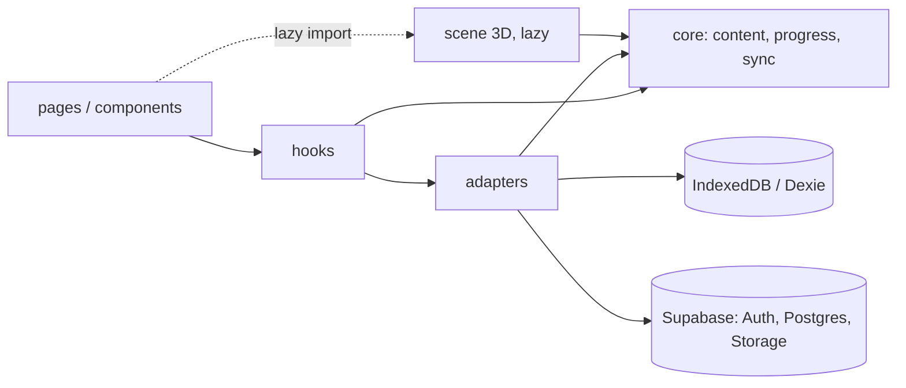
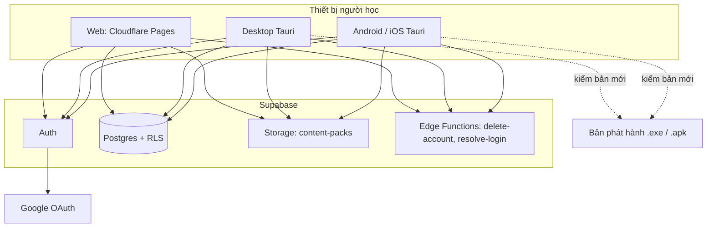
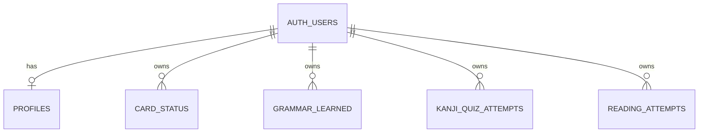

# Architecture Spine — Luyện JLPT đa nền tảng

## Design Paradigm

Ports-and-adapters trong `frontend/`. Lõi (`core/`) là TypeScript thuần: kiểu nội dung, mô hình Tiến độ, máy Đồng bộ. Lõi khai báo cổng; adapter hiện thực cổng; giao diện React chỉ gọi lõi qua hook.

| Lớp | Thư mục | Được phụ thuộc vào |
| --- | --- | --- |
| Lõi | `frontend/src/core/` | không gì ngoài thư viện chuẩn |
| Adapter | `frontend/src/adapters/` (content-pack, local-store, supabase-sync, auth) | lõi, SDK ngoài |
| Giao diện | `frontend/src/{pages,components,hooks}/` | lõi, adapter qua `hooks/` |
| Cảnh 3D | `frontend/src/scene/` | lõi (Cấp độ), token thiết kế |



## Invariants & Rules

### AD-1 — Bố cục thư mục theo vai trò [ADOPTED]
- **Binds:** all
- **Prevents:** code backend lẫn vào frontend và ngược lại; hai nơi chứa cùng một loại tài sản.
- **Rule:** `frontend/` chỉ code giao diện web; `backend/` chỉ code máy chủ (Supabase migrations, functions, tests; ICP cũ xoá khi Supabase thay thế, không chuyển dữ liệu); `desktop/` và `mobile/` chỉ vỏ Tauri; `infra/` chứa dataset, script sinh Gói nội dung, cấu hình hạ tầng; `docs/` chứa tài liệu; `tests/` chứa E2E xuyên hệ thống. `src/` bị xoá sau khi chuyển.

### AD-2 — Giao diện không gọi dịch vụ ngoài trực tiếp
- **Binds:** R5, R6, R8, R9, R10, R11, R13
- **Prevents:** trang tự gọi Supabase làm hỏng ngoại tuyến và Đồng bộ.
- **Rule:** chỉ `adapters/` import `@supabase/supabase-js` và `dexie`. Trang và component đọc/ghi Tiến độ qua hook gọi cổng `ProgressRepository` của lõi. Kiểm bằng luật lint chặn import.

### AD-3 — Gói nội dung là JSON có phiên bản, theo Cấp độ
- **Binds:** R1, R2, R3, R4, R7, R14
- **Prevents:** mỗi màn hình tự định nghĩa dữ liệu; thêm Cấp độ phải sửa code.
- **Rule:** `infra/content/` là nguồn; `infra/scripts/build-packs` sinh `packs/<level>/<semver>/{manifest.json, vocabulary.json, kanji.json, compounds.json, grammar.json, comparisons.json, conjugations.json, keigo.json, verb-pairs.json, reading.json}`. `manifest.json` ghi `level`, `version`, số bản ghi từng bảng, sha256 từng file. Lõi kiểm schema khi nạp; gói hỏng bị bỏ, dùng gói trước.

### AD-4 — Phân phối Gói nội dung
- **Binds:** R4, R17
- **Prevents:** app cài không có nội dung khi ngoại tuyến lần đầu; hai cơ chế cập nhật song song.
- **Rule:** bản build nhúng Gói N4 mới nhất làm hạt giống ngoại tuyến. Gói mới đặt ở bucket công khai `content-packs` của Supabase Storage với `index.json` liệt kê phiên bản mới nhất theo Cấp độ. App kiểm `index.json` khi có mạng, tải gói mới vào IndexedDB, dùng bản mới nhất hợp lệ có trong máy. `[ASSUMPTION: trả lời prd OQ-5]`

### AD-5 — Mã Mục nội dung toàn cục và bất biến
- **Binds:** R3, R10, R11
- **Prevents:** Tiến độ mồ côi khi đổi gói hay thêm Cấp độ.
- **Rule:** N4 giữ nguyên mã hiện có (`vocab-TV-26-01`, `kanji-K-60AA`, `compound-KC001`, `grammar-G001`, mã bài đọc). Cấp độ mới thêm tiền tố mã cấp: `n3-vocab-…`. Mã không bao giờ đổi nghĩa hay tái sử dụng; CI so mã giữa phiên bản gói và báo mã bị xoá.

### AD-6 — Kho cục bộ duy nhất: IndexedDB qua Dexie
- **Binds:** R5, R10, R17
- **Prevents:** hai schema cục bộ (IndexedDB trên web, SQLite trên app) lệch nhau.
- **Rule:** mọi nền tảng, kể cả WebView của Tauri, lưu Gói nội dung, Tiến độ và hàng đợi gửi đi trong một DB Dexie `luyen-jlpt`, có số phiên bản schema và migration Dexie.

### AD-7 — Mô hình Đồng bộ
- **Binds:** R10, R11
- **Prevents:** mất hoặc nhân đôi Tiến độ khi nhiều thiết bị ghi.
- **Rule:**
  - Mỗi thao tác ghi = một dòng hàng đợi (outbox) với `op_id` UUID, ghi cục bộ trước rồi gửi.
  - Bảng trạng thái (`card_status`, `grammar_learned`): khoá `(user_id, level, item_id)`, cột `client_updated_at`; máy chủ chỉ ghi đè khi `client_updated_at` mới hơn (last-writer-wins, kiểm ở SQL, không ở client). Bỏ đánh dấu là `learned = false`, không xoá dòng.
  - Bảng lượt (`kanji_quiz_attempts`, `reading_attempts`): khoá chính là UUID do client sinh; `insert … on conflict do nothing`.
  - Kéo về theo con trỏ `server_updated_at` (máy chủ đặt) cho từng bảng.
  - Số liệu tổng hợp (lần làm, điểm cao nhất) tính từ bảng lượt, không lưu riêng.
  - Mọi dòng Tiến độ có cột `level`, do client ghi từ Gói nội dung chứa Mục đó lúc ghi; không ai suy Cấp độ từ chuỗi mã.

### AD-8 — Schema và bảo vệ dữ liệu ở Postgres
- **Binds:** R9, R13, ràng buộc bảo mật
- **Prevents:** đọc chéo Tài khoản; dữ liệu kích thước tùy ý.
- **Rule:** mọi bảng Tiến độ có `user_id uuid references auth.users on delete cascade`, RLS bật, chính sách `user_id = auth.uid()` cho select/insert/update. CHECK: `item_id` 1–128 ký tự, `total` 1–1000, `score <= total`, `cardinality(wrong_item_ids) <= total`. Xoá Tài khoản qua Edge Function dùng service role xoá `auth.users`; cascade xoá Tiến độ. Service role key chỉ ở `backend/`, không bao giờ trong `frontend/`, `desktop/`, `mobile/`.

### AD-9 — Xác thực
- **Binds:** R9, R15, R16
- **Prevents:** mỗi nền tảng một luồng đăng nhập khác nhau.
- **Rule:** Supabase Auth với hai provider: Email (mật khẩu, bắt buộc xác nhận email) và Google OAuth (PKCE). Tên đăng nhập lưu ở `profiles.username` (unique, không phân biệt hoa thường, 3–32 ký tự `[a-z0-9_]`), ghi lúc đăng ký trong cùng luồng tạo user. Đăng nhập bằng tên đăng nhập: Edge Function `resolve-login` nhận tên và mật khẩu qua HTTPS, xác thực với Supabase Auth rồi chỉ trả cặp token cho client; không trả lỗi khác nhau giữa "không có user" và "sai mật khẩu", có giới hạn tần suất. Web dùng redirect thường; Tauri dùng deep link `luyenjlpt://auth-callback` (plugin deep-link) cho Google và liên kết xác nhận/đặt lại mật khẩu, rồi `exchangeCodeForSession`. Phiên lưu qua storage adapter của supabase-js trỏ vào Dexie. Khách: Tiến độ gắn `user_id = 'guest'` cục bộ, gộp khi đăng nhập (hỏi người dùng).

### AD-10 — Vỏ Tauri
- **Binds:** R15, R16, R17
- **Prevents:** vỏ desktop và mobile tải hai bản frontend khác nhau.
- **Rule:** `desktop/src-tauri` và `mobile/src-tauri` là hai crate Tauri 2, cùng `frontendDist = ../../frontend/dist`, cùng identifier gốc `vn.luyenjlpt.app` (mobile thêm hậu tố nền tảng khi store yêu cầu). Vỏ không chứa logic học; chỉ quyền (capabilities), deep link, updater (desktop), cấu hình cửa sổ. Không thêm lệnh Rust tùy biến nếu plugin chính thức làm được. Phân phối trực tiếp, không store: Windows là bộ cài NSIS `.exe` + plugin-updater đọc `latest.json` ký bằng khoá updater; Android là `.apk` ký bằng keystore riêng (giữ ngoài repo, trong secret CI), app so `versionCode` với `android-latest.json` công khai và mở liên kết tải `.apk` mới. File phát hành đặt ở GitHub Releases hoặc Supabase Storage bucket `releases`. `[ASSUMPTION]`

### AD-11 — Lớp 3D tách biệt
- **Binds:** R18
- **Prevents:** màn học phụ thuộc WebGL; bundle học phình vì three.js.
- **Rule:** chỉ `frontend/src/scene/` import `three`, `@react-three/*`. Cảnh được `React.lazy` sau khi nội dung 2D đã render. Một hook `useMotionPreference()` (lõi) quyết định 3D/tĩnh từ `prefers-reduced-motion`, cài đặt người dùng và kiểm tra WebGL/fps; mọi cảnh và timeline GSAP đọc hook này. Lenis chỉ gắn ở route `/`. GSAP là thư viện timeline duy nhất cho chuyển cảnh mới.

### AD-12 — Giới hạn dữ liệu tại mọi ranh giới tin cậy [ADOPTED]
- **Binds:** all
- **Prevents:** tái diễn lỗi review #1.
- **Rule:** dữ liệu đi lên máy chủ được giới hạn bằng CHECK ở Postgres (AD-8); Gói nội dung tải về được kiểm schema và sha256 trước khi dùng.

## Consistency Conventions

| Concern | Convention |
| --- | --- |
| Đặt tên | Bảng/cột Postgres `snake_case`; TypeScript `camelCase`, kiểu `PascalCase`; route giữ tiếng Việt không dấu (`/tu-vung`); file component `PascalCase.tsx`. |
| Thời gian | Lưu `timestamptz` UTC; client gửi ISO 8601; không còn nanosecond ICP. |
| Mã | Mã Mục theo AD-5; UUID v4 cho lượt và `op_id`. |
| Lỗi | Lõi trả `Result<T, AppError>` với `code` cố định (`offline`, `auth`, `validation`, `server`); giao diện ánh xạ `code` sang câu tiếng Việt ở một chỗ. |
| Cấp độ | Kiểu `Level = 'n5' \| 'n4' \| 'n3' \| 'n2' \| 'n1'`; Cấp độ đang chọn là trạng thái lõi, lưu Dexie + `profiles.current_level`. |
| Cấu hình | Biến `VITE_SUPABASE_URL`, `VITE_SUPABASE_ANON_KEY`, `VITE_CONTENT_INDEX_URL`; không bí mật trong frontend. |
| Văn bản | Mọi chuỗi giao diện tiếng Việt; chữ Nhật có `lang="ja"`. |

## Stack

| Name | Version |
| --- | --- |
| React / React DOM | 19.1 (giữ bản hiện có) |
| Vite | 8.x (hiện có) |
| TypeScript | 7.x (hiện có) |
| TanStack Router / Query | 1.131 / 5.x (hiện có) |
| Tauri CLI / API | 2.12.6 / 2.12.5 |
| @tauri-apps/plugin-deep-link / plugin-updater | 2.6.3 / 2.14.1 |
| @supabase/supabase-js | 2.119.2 |
| Supabase CLI | 3.2.0 |
| Dexie | 4.4.7 |
| three / @react-three/fiber / @react-three/drei | 0.187.0 / 9.8.2 / 10.7.9 |
| gsap / @gsap/react | 3.15.1 / 2.1.2 |
| lenis | 1.3.27 |
| Vitest | 5.1.1 |
| Playwright | 1.65.1 |

## Structural Seed

```text
Luyen_JLPTN4/
  frontend/            # React + Vite (chuyển từ src/frontend)
    src/core/          # content, progress, sync, level (TS thuần)
    src/adapters/      # content-pack, local-store (Dexie), supabase-sync, auth
    src/scene/         # 3D (R3F), lazy
    src/pages/ components/ hooks/
  backend/
    supabase/          # migrations/, functions/{delete-account,resolve-login}/, tests/ (pgTAP)
  desktop/src-tauri/   # vỏ Windows/macOS/Linux
  mobile/src-tauri/    # vỏ Android/iOS
  infra/
    dataset_n4_minnanihongo/  # nguồn N4 (giữ nguyên)
    content/n4/        # nội dung soạn tay (bài đọc)
    scripts/           # build-packs, verify-packs
    packs/             # output (gitignore), upload lên Storage
  tests/e2e/           # Playwright web + cấu hình chạy trong Tauri
  docs/
```





Môi trường: `local` (`supabase start` trong Docker), `staging` (dự án Supabase riêng), `production`. CI: GitHub Actions; job iOS chạy trên runner macOS. `[ASSUMPTION: GitHub Actions và Cloudflare Pages]`

## Capability → Architecture Map

| Capability | Lives in | Governed by |
| --- | --- | --- |
| R1 Chọn Cấp độ | `core/level`, header | AD-3, Conventions: Cấp độ |
| R2, R3 Gói N4 đầy đủ, mã ổn định | `infra/scripts`, `core/content` | AD-3, AD-5 |
| R4, R17 Cập nhật gói, ngoại tuyến | `adapters/content-pack`, Dexie | AD-4, AD-6 |
| R5, R6, R8 Thẻ, trắc nghiệm, đọc hiểu | `pages/*`, `core/progress` | AD-2, AD-7 |
| R7 Ngữ pháp mở rộng | `pages/grammar/*` | AD-3 |
| R9, R13 Đăng ký/đăng nhập, xoá Tài khoản | `adapters/auth`, `backend/supabase/functions` | AD-8, AD-9 |
| R10, R11 Đồng bộ, Tiến độ theo Cấp độ | `core/sync`, `adapters/supabase-sync`, `backend/supabase/migrations` | AD-7, AD-8 |
| R12 | đã bỏ | — |
| R14 Web giữ route | `frontend/src/App.tsx` | AD-1 |
| R15, R16 Desktop, mobile | `desktop/`, `mobile/` | AD-10 |
| R18 3D | `scene/` | AD-11 |

## Deferred

- Chi tiết cột từng bảng Postgres: epic-tai-khoan-dong-bo quyết định trong migration, giữ AD-7, AD-8.
- Nâng React 19.3 và thay `motion` bằng GSAP hoàn toàn: không chặn epic nào, làm khi tiện.
- Chế độ tối: chờ UX.
- Ký mã Windows (code signing certificate): bản cho bạn bè chấp nhận cảnh báo SmartScreen; mua chứng chỉ khi phân phối rộng hơn.
- Phát hành App Store/Google Play: ngoài phạm vi (prd OQ-1 đã chốt).
- Bản macOS/Linux cho bạn bè: chờ prd OQ-6.
- Quan sát vận hành (log lỗi client, theo dõi Đồng bộ): epic-tai-khoan-dong-bo chọn công cụ; tối thiểu là log Supabase.
