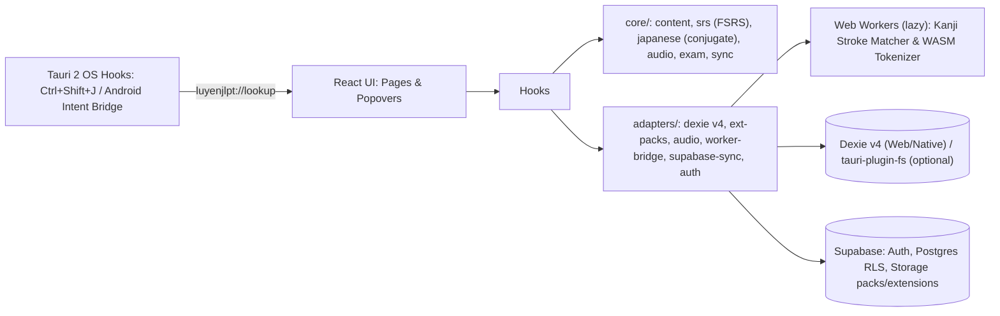
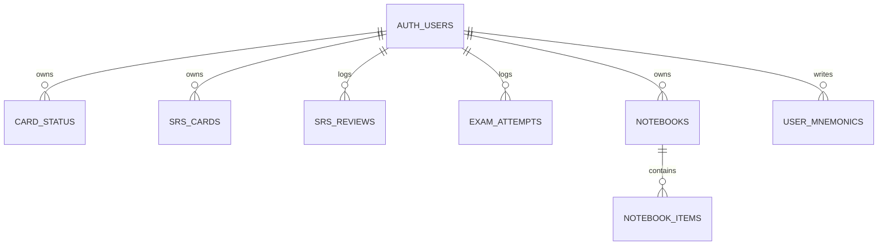

# Đối chiếu Mazii.net & Kế hoạch phát triển v2 (Chuẩn BMAD)

Tài liệu này tổng hợp kết quả kiểm kê mã nguồn hiện tại của `Luyen_JLPTN4`, kết quả phân tích kỹ thuật bằng chứng thực thi (REA) trên `https://mazii.net/vi-VN`, và đề xuất **kế hoạch phát triển v2 theo chuẩn BMAD** cho cả bản Web lẫn App đa nền tảng (Tauri 2 Desktop/Mobile).

Mọi thay đổi đều bám các bất biến đã chốt của dự án: kiến trúc `ports-and-adapters` (`AD-1..AD-12`), thẩm mỹ **Washi & Sumi 3D**, kho cục bộ Dexie + đồng bộ Supabase RLS, đường dẫn tiếng Việt không đổi và dữ liệu Minna no Nihongo N4 bài 26–50 làm nền.

---

## 1. Tóm tắt điều hành & Bằng chứng REA

### 1.1 Kết luận cốt lõi

- **Điểm hơn hẳn của `Luyen_JLPTN4` so với Mazii.net:**
  - **Ngoại tuyến thực sự trên cả Web lẫn App:** Toàn bộ gói học N4 (`1.182` từ vựng, `118` kanji, `388` từ ghép gộp từ `403` dòng nguồn, `148` mẫu ngữ pháp, `27` bài so sánh, `22` bảng chia, `17` kính ngữ, `12` cặp tự/tha động từ, `8` bài đọc) và `9` đề thi thử (`719` câu) chạy hoàn toàn từ IndexedDB/Dexie (`frontend/src/adapters/local-store/db.ts`). Ngược lại, Mazii Web đăng ký `0` Service Worker, `0` Cache Storage và chỉ lưu Firebase config trong IndexedDB (`ev_e6d18dea...`), tức là phụ thuộc mạng hoàn toàn trên trình duyệt.
  - **Sạch quảng cáo & không khóa tính năng cốt lõi:** Khi mở `mazii.net/vi-VN` chưa đăng nhập, trình duyệt gọi tới **105 tên miền** (`30+` mạng quảng cáo/header-bidding như DoubleClick, Criteo, Pubstack, Anymind360), bị chặn màn hình bởi modal giới thiệu AI và giới hạn `500` từ lưu sổ tay, `5` trang lịch sử, chỉ mở `3` đề JLPT miễn phí mỗi cấp (`ev_96de1937...`, `ev_27efb6f9...`, `ev_03eafdd8...`).
  - **Chiều sâu giáo trình Minna N4 có cấu trúc:** Liên kết hai chiều giữa mẫu ngữ pháp và `27` bài so sánh (`64/74` vế khớp tự động trong `frontend/src/core/content/comparisonLinks.ts`), tách riêng bảng chia, kính ngữ và cặp tự/tha động từ — thứ Mazii không biên tập thành bảng đối chiếu chuyên biệt mà rải trong bình luận cộng đồng (`ev_b7228f33...`).
- **Khoảng trống lớn nhất cần lấp để vượt Mazii cho người Việt học JLPT:**
  1. **Chưa có lịch ôn lặp lại ngắt quãng (FSRS):** Flashcard hiện chỉ là cờ nhị phân `known`/`unknown`, chưa có nhịp ôn lại theo đường cong quên; Mazii đã chạy FSRS phía máy chủ (`chunk-2UQI4PZK.js`).
  2. **Thiếu hoàn toàn âm thanh & luyện nghe thực tế:** Dự án chưa có phát âm TTS cho từ vựng/ngữ pháp/đọc hiểu, và `6/9` đề thi N4 có câu nghe nhưng hiện **0 file `.mp3`/`.m4a`** được phân phối (người học phải đọc script hoặc bỏ qua).
  3. **Thiếu tra cứu Nhật–Việt / Việt–Nhật tổng quát và tra nhanh tại chỗ (click-to-lookup):** Hiện chỉ tra được kanji/từ ghép N4 ở `/kanji/tra-cuu`, chưa tra được từ vựng toàn cục hay chạm vào từ trong bài đọc/đề thi để xem nghĩa ngay.
  4. **Kanji thiếu nét viết động (stroke order), bộ thủ, mẹo nhớ và tập viết tay.**
  5. **Đề thi thử chưa đồng bộ Supabase & dễ mất bài khi tải lại trang:** `examAttempts` chỉ nằm ở Dexie v3 cục bộ, không đồng bộ đa thiết bị, và bộ đếm/đáp án đang làm bị mất nếu reload.

### 1.2 Hồ sơ bằng chứng REA (Phân tách Quan sát / Suy luận / Chưa xác minh)

Toàn bộ phiên thu thập thực hiện trên Chromium `158.0.8127.37` (`locale: "vi-VN"`, viewport `1280×800`) qua REA v6.7.0. **Không vượt CAPTCHA, không vượt tường đăng nhập và không vượt tường trả phí.**

#### A. Quan sát trực tiếp (Observations — có Evidence ID)

| Nhóm quan sát | Bằng chứng REA (`ev_*`) | Ghi nhận đã xác thực |
| --- | --- | --- |
| Trang đích, ad-tech & kiến trúc Web | `ev_113f87de88cf53eaf700b412268c755a9fdd4ffb04787107afbccb323f969f8e`, `ev_96de1937ea5e44e20f7a62896d675ff52739caf9e57db669976ce01e38c45c1f`, `ev_e6d18dea4b277cbe1ed5e80f672afea247e04980e13b8fb3b067a6b60df9957e` | Angular `18.2.14`; `1.360` sự kiện mạng, **105 domain** (30+ ad-tech); `<app-ai-intro-modal>` che màn hình lần đầu; `workers: []`, `cache_names: []`, IndexedDB chỉ có 3 kho Firebase (`352.333` bytes) dù có `manifest.json`. |
| Đồ thị bundle & mã JS tĩnh | `ev_f8556955fe4662c3abd2c72b287bc3896b77b4091eb278b494392444c95e3884`, `ev_27efb6f9c1080cc1bc76b6738606e4a35715849f6af36d7cfa85738312eb2cfc`, `ev_0c0cb9974071ad17e14dd875d00af4ab382d0cfe54ab3de1fb4116580b14a1db` | `106` chunk (`3,23 MB` JS trên landing), `678` cạnh, `35` đường dẫn router, `16+` host API (`mazii.net/api`, `api/api2/api3`, `hub`, `jlpt`, `notebook`, `sync`, `ocr`, `api-conversation`, `data`, `audio`, `mina`, `resource`). Xác nhận FSRS (`chunk-2UQI4PZK.js`), giới hạn miễn phí `Lt = 500` từ (`chunk-2DLI7FRG.js`), lịch sử tìm kiếm tối đa `5` trang (`chunk-3UNAI33S.js`), Dmak + KanjiVG (`chunk-LZ42PKAD.js`), vẽ tay gọi `inputtools.google.com` (`chunk-6JFEAGKG.js`), chấm phát âm 5 chỉ số (`chunk-3QTZW7UP.js`). Ngoài ra `assets/i18n/vi.json` (`153.333` bytes, `1.668` khóa) & `main-CKMXJCG7.js` (`53` lazy chunks) xác nhận `191` khóa từ chuyên ngành, Import Excel tối đa `500` dòng, Export PDF, `/learning-milestones` và `/checkin`. |
| Tra từ (JA↔VI, chia động từ, pitch, TTS) | `ev_97daed933296cc14b081a39dc87711c6f6f54d4d4678426d25738614a8a40ae6`, `ev_02706b2f49eea2de3cfad120ef4c1afbcca766ae5c774ca3e46a3d0d073202ee`, `ev_74c7a119a8484cfd0e7287760da64d31e1b92fa05157c881773c888947f3c43f` | Gợi ý trực tiếp `POST /api/suggest/v3`; chi tiết `食べる` có pitch accent, TTS `data.mazii.net/audios/ja-JP/`, bảng chia **13 thể** (`app-verb-conjugtion`), ảnh minh họa (`app-word-image`), kết hợp từ, trích dẫn báo chí, thẻ kanji nhúng, `17` góp ý cộng đồng. Tra ngược VI→JA (`học`) hoạt động trực tiếp. |
| Kanji (Hán Việt, nét vẽ, mẹo nhớ) | `ev_93a4c10aaf5ecf9253b97bf972b8016d53494103ca7947d2f6979dd0082fc1c8` | Chữ `食`: Hán Việt `THỰC, TỰ`, `9` nét, JLPT N5, tần suất `#328/2500`, SVG động Dmak/KanjiVG có nút vẽ lại, phân tách bộ thủ (`良` + `𠆢`), `33` mẹo nhớ cộng đồng, từ ghép nhóm theo Kunyomi/Onyomi, vẽ tay và tra theo bộ thủ. |
| Ngữ pháp | `ev_d91e8057c8d55e3d294fcba58418a28cca47ba1ed8281c9cb558946b93d6463f`, `ev_b7228f33fa3bb2865b92e97b6ed1f01165f0c617f45db1b1227b73ed68693e71`, `ev_c56e21596a38d0cb0ea0c5a6ceb7f91759b224bbad4083b46f51b9ec0da8bdaf` | Lọc theo cấp độ + chức năng (`Chức năng`); chi tiết `Vて + しまう` có sắc thái nghĩa, **12 ví dụ có furigana + nút nghe** và mẹo rút gọn `Vちゃう`. Thư viện N4 thống kê `522` từ vựng, `436` ngữ pháp, `167` kanji; danh sách từ trái nghĩa (`7.747`), tự động từ (`2.568`), tha động từ (`3.485`). |
| Thi thử JLPT | `ev_e48a48fb6d4a982b15793f25f96dc273da8155dccf799f5d2e9ca39ae47bba9f`, `ev_03eafdd871c21fe86270f3f8d353719b9a99f8214a2ea7cd559488127ef2d920`, `ev_a8b16c844de3c88ee4aff06367368d9c0f47ffd1f849477f06e1601de92b3103` | Hỗ trợ JLPT, JFT-Basic, JLCT; bảng xếp hạng tuần 180 điểm. N4 mở miễn phí `Đề 01–03`, khóa `Đề 04–11+` (Premium) và bán lẻ đề dự đoán Kosei (`59.000₫/đề`). `Đề 01` (`635`): 85 câu (28 Từ vựng + 29 Ngữ pháp/Đọc + 28 Nghe), điểm đỗ `90/180`, bắt buộc trực tuyến (lệch nhẹ: thẻ ngoài ghi `115 phút`, modal ghi `105 phút`). |
| Đọc báo & Dịch thuật | `ev_7c10e74caa8a9c29f7af7fafb8bb1fe598540ac61741406ea484101244146d64`, `ev_c6f314482ec63ed4d8749e7bd25e7e0bcc52561965e2c6afd63715834fdb568e`, `ev_43727866a75f5ed8f873197e02faf9ffdac89e15ed182de1bf91a21cca817ef2` | Đọc báo nguồn Todaii/NHK Easy: bật/tắt furigana, phát MP3 (`HTTP 206`), popup tra từ khi chạm (`app-word-lookup-host`), tự động bóc ngữ pháp trong bài (`POST /api/gramanalys`), bản dịch cộng đồng. Trang Dịch (`0/5.000` ký tự): phân tách hình thái học (`POST /api/tokenizer` kiểu MeCab IPADIC), kiểm tra ngữ pháp (`app-check-grammar`), OCR ảnh (`ocr.mazii.net/ocr/overlay`). |
| Sổ tay, Cộng đồng, AI & Gói trả phí | `ev_7ead6a084ab34b0e522208be2d5e5911490a754f8ef86fd5546f96c311e65c55`, `ev_71654ed4d9757719bd2a66633b4f2cc18adb06f55181199154b42d00539828ee`, `ev_11b2bb5804349266d300f10c266815d330b1ca1d425636a2b0116df77adc1d6f`, `ev_d8ca4d7bad179e458a38603827fe66b2460d07b25f41103eea94c2a6f943d54d`, `ev_3d9357f282902b61c9681ebdcc604106d4e000f36076cb2469ad7e7af8140ce8` | Kho sổ tay chia sẻ có sẵn bộ Minna 50 bài, Mimikara, Tango; `/vi-VN/note` trống khi chưa đăng nhập; Q&A có `17` chủ đề; `Maziiko` AI hội thoại có `45` tình huống mẫu; Premium giá trực tiếp `299.000₫`/3 tháng, `419.000₫`/1 năm, `699.000₫`/trọn đời, đồng bộ tối đa **3 thiết bị**. |

#### B. Suy luận có giới hạn (Inferences)

1. **Dịch vụ chấm phát âm:** Bộ 5 trường điểm (`accuracyScore`, `completenessScore`, `fluencyScore`, `pronScore`, `prosodyScore` + `errorWords`) trong `chunk-3QTZW7UP.js` trùng khớp đặc tả của Azure AI Speech Pronunciation Assessment chạy qua proxy backend của Mazii.
2. **Bộ tách từ hình thái học:** Nhãn từ loại từ `POST /api/tokenizer` (`動詞, 自立`, `助詞, 格助詞`, `助動詞, *`) tương ứng MeCab/Kuromoji dùng từ điển IPADIC trên máy chủ.
3. **Ngoại tuyến chỉ có trên app di động native:** Do bản Web không có Service Worker/IndexedDB từ điển và gửi nét vẽ tay lên Google Input Tools, tính năng *"Từ điển offline"* và *"Nhận dạng chữ viết tay offline"* ghi ở `/vi-VN/upgrade` chỉ được đóng gói trong ứng dụng Android/iOS native.

#### C. Phần chưa xác minh / Giới hạn phạm vi (Unknowns & Limitations)

- **Luồng yêu cầu đăng nhập (không vượt tường):** Giao diện CRUD sổ tay `/vi-VN/note`, phiên ôn flashcard FSRS thực tế (4 nút `Again/Hard/Good/Easy`), lịch sử dịch, đăng bài `/vi-VN/qa` và cơ chế giải quyết xung đột của `sync.mazii.net`.
- **Luồng trả phí / token:** Đầu ra trực tiếp của `Dịch AI`, bảng giá chi tiết trong tab `Mazii AI`, nội dung `Đề 04–11` & Kosei, và màn hình đang làm bài thi sau khi bấm `Bắt đầu làm bài` (giao diện đồng hồ, trình phát Choukai, màn hình chấm điểm chi tiết).
- **Thiết bị & nhị phân di động:** Chưa kiểm tra trực tiếp file APK (`com.mazii.dictionary`) / IPA (`id933081417`), chưa chạy vòng lặp micro chấm phát âm thật và chưa ghi nhận body phản hồi của `ocr.mazii.net/ocr/overlay` hay bố cục file PDF từ `app-writing-pdf`.
- **Giới hạn công cụ thu thập:** Các sự kiện mạng từ kịch bản Playwright không lưu nội dung phản hồi (`response_body: false`) và không có initiator stack; phần phân tích JS tĩnh chỉ xuất `106` chunk tải ở trang đích (các lazy chunk của `Exam`, `Note`, `Translate`, `AI Conversation` được quan sát qua DOM, cây trợ năng và mạng lúc chạy).

---

## 2. Bảng đối chiếu toàn diện: Dự án hiện tại vs Mazii.net

| Hạng mục | `Luyen_JLPTN4` hiện tại (Đã xác thực trong mã nguồn) | Mazii.net (Web + App theo REA & danh mục công khai) | Đánh giá vị thế |
| --- | --- | --- | --- |
| **Nền tảng phân phối** | 1 codebase React/Vite dùng chung cho Web, Windows `.exe` (NSIS + auto-updater), Android `.apk` (ký tự động), iOS (CI simulator, chưa phát hành store). `desktop/src-tauri/`, `mobile/src-tauri/`. | Web Angular + App Android/iOS + tiện ích Chrome/Firefox. Không có app Desktop native chính thức. | **Ta có lợi thế Desktop native** (Tauri nhẹ, có thể thêm phím tắt toàn hệ thống). |
| **Ngoại tuyến (Offline-first)** | Toàn bộ nội dung N4 + `9` đề thi + tiến độ chạy 100% từ Dexie (`luyen-jlpt` v3) trên cả Web lẫn App; hàng đợi outbox tự đồng bộ Supabase. | Web hoàn toàn phụ thuộc mạng (`0` SW, `0` Cache). App di động cho tải từ điển & viết tay offline nhưng khóa sau gói Premium. | **Lợi thế cạnh tranh cốt lõi của ta.** |
| **Quảng cáo, theo dõi & trả phí** | 0 quảng cáo, 0 tracker, 100% miễn phí cho người dùng cá nhân/bạn bè (`AGPL-3.0-only`). | 105 domain trên landing (30+ ad-tech), modal chặn màn hình, khóa sổ tay 500 từ, khóa đề 04+, giới hạn đồng bộ 3 thiết bị. | **Lợi thế rõ rệt về trải nghiệm tập trung.** |
| **Từ vựng & SRS** | 1.182 từ Minna bài 26–50, lọc Bài/Mục, thẻ lật 3D CSS, Hán Việt, ghi chú, trạng thái `known`/`unknown`. Thiếu SRS, thiếu tìm kiếm từ vựng, thiếu âm thanh, thiếu sổ tay riêng. | Từ điển JA↔VI rộng, pitch accent, TTS, ảnh minh họa, chia 13 thể, FSRS phía máy chủ, sổ tay cộng đồng & cá nhân (Excel import 500 dòng, xuất PDF). | **Mazii vượt xa về tra cứu, âm thanh & SRS.** |
| **Kanji** | 118 kanji + 388 từ ghép N4 (từ 403 dòng nguồn), tra cứu bỏ dấu + đổi Katakana→Hiragana (`/kanji/tra-cuu`), trắc nghiệm 3 chế độ (đơn/ghép/trộn) có Hán Việt và tách chữ cấu thành. Thiếu thứ tự nét, bộ thủ, mẹo nhớ, viết tay. | 12.000+ kanji, Dmak/KanjiVG nét động, phân tách bộ thủ, tần suất, hàng chục mẹo nhớ cộng đồng, từ ghép tách Kun/On, vẽ tay (online trên web, offline trên app), xuất PDF tập viết. | **Mazii vượt xa về chiều sâu học Kanji.** |
| **Ngữ pháp** | 148 mẫu N4 rõ ràng (cách nối V/Aい/Aな/N, nghĩa, cách dùng, ví dụ) + **4 trang chuyên biệt**: 27 bài so sánh (liên kết 2 chiều `64/74`), 22 bảng chia, 17 kính ngữ, 12 cặp tự/tha động từ. Thiếu furigana cho ví dụ (`example.reading` trống), thiếu audio, thiếu bài tập tương tác. | N5–N1 (N4: 436 mẫu), lọc theo chức năng, 10–12 ví dụ có furigana + nút nghe, nhận diện ngữ pháp tự động trong câu/báo. Thiếu trang so sánh 2 cột biên tập sẵn. | **Ta mạnh hơn về cấu trúc đối chiếu Minna; Mazii mạnh hơn về furigana, audio & phủ cấp độ.** |
| **Đọc hiểu** | 8 bài đọc ngắn/trung bình (`ReadingDetailPage.tsx`), câu hỏi trắc nghiệm, giải thích, dịch gập gọn, danh sách từ mới. Thiếu furigana toggle, thiếu chạm để tra từ, thiếu nguồn bài đọc mới. | Báo Todaii/NHK Easy cập nhật hằng ngày, bật/tắt furigana, MP3 streaming, chạm từ hiện popup tra nghĩa, tự bóc ngữ pháp trong bài, bản dịch cộng đồng. | **Mazii vượt xa về khối lượng, audio & trải nghiệm đọc tương tác.** |
| **Luyện đề JLPT** | 9 đề N4 (`719` câu), khóa tuần tự 3 phần, đếm ngược tự nộp, giải thích & `<RubyText>` sau nộp. **0 file audio nghe hiểu**, không đồng bộ Supabase, mất bài nếu reload. | Đề JLPT/JFT-Basic/JLCT đủ N5–N1, có audio Choukai, lưu tiến độ đang làm trực tuyến, bảng xếp hạng tuần, chạm tra từ lúc chữa bài. Khóa từ đề 04+. | **Ta đã có khung thi tốt nhưng thiếu audio nghe hiểu & đồng bộ.** |
| **Dịch, OCR & AI** | Chưa có (đúng phạm vi v1). | Dịch văn bản/hội thoại, tách từ MeCab IPADIC, kiểm tra ngữ pháp, OCR ảnh, Maziiko luyện nói AI 45 tình huống, chấm phát âm 5 chỉ số. | **Mazii dẫn đầu; ta cần chọn lọc công cụ hữu ích nhất mà không phá vỡ offline-first.** |
| **Tiến độ & Động lực** | Dashboard theo cấp độ (`/tien-do`), top 10 kanji hay sai, lịch sử thi cục bộ, trạng thái trống sạch. Thiếu biểu đồ xu hướng, chuỗi ngày (streak), mục tiêu ngày và nút "ôn ngay câu hay sai". | `/checkin` điểm danh, `/learning-milestones` huy hiệu/mục tiêu, tổng kết tuần (`app-summary-week`), bảng xếp hạng. | **Mazii mạnh hơn về duy trì thói quen học.** |
| **Thẩm mỹ & Tối ưu thị giác** | Washi & Sumi 3D (`DeskHeroCanvas`, `HankoStamp`, `PaperTiltCard`), tôn trọng giảm chuyển động, tách rõ font Việt/Nhật. Token `.dark` đã viết sẵn trong `index.css` nhưng chưa bật công tắc. | Giao diện thực dụng, nhiều mật độ thông tin nhưng rối vì banner/ad slots và popup upsell. | **Vượt trội về sự tĩnh lặng và độ dễ đọc lâu.** |

---

## 3. Nhóm 1 — Chức năng hiện tại chưa tốt so với Mazii (Cần nâng cấp trước)

Đây là những mảnh ghép dự án **đã có nền** nhưng trải nghiệm thực tế còn hụt rõ rệt so với Mazii. Sửa nhóm này đem lại giá trị ngay cho người học N4 mà không phá vỡ kiến trúc hiện hành.

1. **Từ vựng mới dừng ở flashcard nhị phân, thiếu tìm kiếm & phát âm (`frontend/src/pages/VocabularyPage.tsx`, `Flashcard.tsx`)**
   - *Hiện trạng:* Người học chỉ bấm `Đã thuộc` / `Chưa thuộc`, không có lịch ôn lặp lại, không nghe được phát âm chuẩn của 1.182 từ, không có ô tìm từ nhanh trong trang Từ vựng, và bộ lọc Bài/Mục bị reset mỗi lần rời trang.
   - *So với Mazii:* Mazii có TTS ngay trên từng thẻ/từ vựng (`ev_02706b2f...`) và lịch ôn FSRS (`chunk-2UQI4PZK.js`).
   - *Hướng nâng cấp:* Nâng lõi thẻ sang **FSRS 4 mức** (giữ tương thích ngược với `card_status`), thêm nút phát âm (Web Speech `ja-JP` làm đường lui + gói audio Opus offline tùy chọn), thêm ô tìm từ bỏ dấu/kana và lưu bộ lọc đang chọn vào `db.settings`.

2. **Luyện đề JLPT thiếu hoàn toàn audio Choukai, mất bài khi reload và không đồng bộ Supabase (`frontend/src/pages/ExamRunnerPage.tsx`, `ExamListPage.tsx`, `adapters/local-store/exams.ts`)**
   - *Hiện trạng:* `6/9` đề có 28 câu Nghe hiểu nhưng repo không phân phối `.mp3`/`.m4a` (chỉ có kịch bản chữ và `imageHint` dạng văn bản). Bảng `examAttempts` chỉ ở Dexie v3, không nằm trong `PROGRESS_KINDS` nên không đồng bộ đa thiết bị; `purgeOwner` cũng chưa xóa `examAttempts` cục bộ khi đổi/xóa tài khoản. Nếu tải lại trang hoặc app di động bị hệ điều hành đóng nền giữa giờ thi, toàn bộ đáp án và thời gian còn lại bị mất. Ngoài ra `ExamListPage.tsx` đang hardcode chú thích thời lượng N4 và kiểm tra thiếu gói bằng chuỗi `": 404"`.
   - *Hướng nâng cấp:*
     - Lưu nháp bài thi đang làm (`activeExamDraft`) vào Dexie mỗi khi chọn đáp án + đồng bộ `exam_attempts` lên Supabase Postgres (kèm RLS và CHECK).
     - Bổ sung cơ chế tải **gói Audio Choukai rời** (định dạng Opus/M4A nén gọn, có trình phát chuẩn JLPT cho phép chọn chế độ *Thi thật 1 lần* hoặc *Luyện tập nghe lại*), và hỗ trợ minh họa SVG/WebP nhẹ cho các câu M1–M2 có `imageHint`.
     - Sửa triệt để các lỗi nhỏ đã ghi nhận trong code review `2026-11-26`: xóa `examAttempts` trong `purgeOwner`, tách kiểm tra lỗi HTTP chuẩn thay vì `": 404"`, lấy thời lượng động theo cấp độ.

3. **Ngữ pháp & Đọc hiểu thiếu Furigana và thiếu tính tương tác (`GrammarDetailPage.tsx`, `ReadingDetailPage.tsx`, `GrammarKeigoPage.tsx`)**
   - *Hiện trạng:* `ExamRunnerPage` đã có `<RubyText>` hỗ trợ `{base|reading}`, nhưng `GrammarExample.reading` trong gói N4 đang bỏ trống và `ReadingDetailPage.tsx` chỉ có `passage.text` thuần (không có `textRuby`). Người đọc gặp từ mới phải tự mở tab khác tra. Trang ngữ pháp cũng chưa có bài tập thực hành chia động từ/kính ngữ/tự-tha động từ dù `GrammarQuiz` component đã tồn tại sẵn trong mã. Ngoài ra `GrammarKeigoPage.tsx:235` đang thiếu thuộc tính `lang="ja"` ở cột `kenjogoII`.
   - *Hướng nâng cấp:* Bổ sung dữ liệu furigana (`textRuby` + công tắc `Hiện Furigana` mặc định bật cho N5/N4, tắt cho luyện thi), tích hợp popup chạm-để-tra từ nội bộ, thêm mini-drill thực hành chia thể / chọn tự-tha động từ / chọn kính ngữ, và sửa thiếu `lang="ja"`.

4. **Kanji Lookup bị "giấu" sâu & Kanji Quiz chưa cho lọc bài hoặc ôn lại chữ sai (`KanjiQuizPage.tsx`, `KanjiLibraryPage.tsx`, `ProgressPage.tsx#L180-L199`)**
   - *Hiện trạng:* `/kanji/tra-cuu` chỉ có link từ màn `QuizStart` (không có trên thanh điều hướng hay lúc đang xem kết quả). Trắc nghiệm Kanji chưa lọc theo Bài Minna; trang `/tien-do` hiển thị danh sách `mostMissed` dạng tĩnh mà không có nút **"Luyện lại 10 chữ hay sai"** một chạm.
   - *Hướng nâng cấp:* Đặt lối vào Tra cứu Kanji rõ ràng ngay trong phân hệ Kanji (tab chuyển `Trắc nghiệm` / `Tra cứu`), thêm lọc theo Bài Minna khi tạo đề Kanji, và gắn nút 1 chạm tạo phiên ôn trực tiếp từ `mostMissed` trên `/tien-do`.

5. **Lệch điều hướng trên Mobile & Chế độ tối đang dở dang (`Layout.tsx#L38-L62`, `index.css#L101-L155`, `App.tsx#L43`)**
   - *Hiện trạng:* `MOBILE_TABS` chỉ có 5 mục (`/`, `/tu-vung`, `/kanji`, `/ngu-phap`, `/tien-do`), bỏ quên `/doc-hieu` và `/luyen-de` khiến người dùng điện thoại phải mở menu hamburger hoặc quay về Trang chủ. Trong khi đó, `index.css` đã khai báo đủ bộ token `.dark`, chỉ thiếu nút chuyển theme, sửa `<Toaster theme="light" />` trong `App.tsx#L43` và bảng màu tối cho cảnh 3D `scene/tokens.ts`.
   - *Hướng nâng cấp:* Tổ chức lại tab dưới điện thoại thành 5 lối vào thông minh (ví dụ gộp Đọc hiểu + Luyện đề vào tab **Luyện tập** hoặc tab **Học** có sub-switch, hoặc dùng thanh tab 5 mục + nút chuyển nhanh không ẩn `Luyện đề`), và hoàn thiện chế độ tối **"Sumi đêm"** trong `AccountPage` + theo hệ điều hành.

---

## 4. Nhóm 2 — Chức năng cực hay trên Mazii cần bổ sung & phát triển thêm

Nguyên tắc kế thừa: **học cơ chế giá trị cao của Mazii, không sao chép dữ liệu độc quyền của Mazii** — toàn bộ dữ liệu mở rộng phải lấy từ nguồn mở hợp pháp (KanjiVG, JMdict, KANJIDIC2, Tatoeba) và ưu tiên chạy được **ngoại tuyến**.

| STT | Tính năng từ Mazii (kèm REA) | Giá trị với người Việt học JLPT | Cách triển khai phù hợp `Luyen_JLPTN4` (Web + Desktop + Mobile) |
| --- | --- | --- | --- |
| **1** | **Thứ tự nét Kanji động + Phân tách bộ thủ + Mẹo nhớ** (`ev_93a4c10a...`, Dmak/KanjiVG) | Giải quyết nút thắt lớn nhất khi học Kanji: nhớ cấu tạo chữ theo bộ thủ kết hợp âm Hán Việt, viết đúng thứ tự nét. | Tích hợp SVG từ **KanjiVG (CC BY-SA 3.0)** theo gói tải rời theo cấp độ (gói 118 kanji N4 chỉ ~250 KB nén, 2.136 Joyo Kanji ~3–4 MB nén). Vẽ nét động trên canvas Washi (mực sumi), tách thành phần bộ thủ, cho người học tự ghi **Mẹo nhớ cá nhân** (đồng bộ Supabase) bên cạnh mẹo biên soạn chuẩn. |
| **2** | **Tập viết tay & nhận dạng nét vẽ Kanji** (`ev_93a4c10a...`, `chunk-6JFEAGKG.js`) | Giúp tra chữ khi gặp ngoài đời mà không biết cách đọc, đồng thời luyện nhớ chủ động bằng tay. | Không lệ thuộc `inputtools.google.com` online như Mazii Web. Dùng thuật toán đối khớp nét vector **thuần JS/TS dựa trên KanjiVG** (như KanjiCanvas/HanziLookup cải tiến) chạy **100% offline** trên cả Web lẫn Tauri Mobile/Desktop (~400 KB chỉ mục nét). Thêm xuất phiếu tập viết PDF in được (`window.print`/SVG-to-PDF) tương tự `app-writing-pdf`. |
| **3** | **Từ điển tra cứu toàn cục JA↔VI + Chạm để tra (Click-to-Lookup)** (`ev_97daed93...`, `ev_02706b2f...`, `ev_74c7a119...`) | Người học không cần rời app sang Mazii mỗi khi gặp từ ngoài bài Minna trong Đọc hiểu hoặc Luyện đề. | Xây thanh tìm kiếm nhanh (`Ctrl+K` trên Web/Desktop, nút kính lúp trên Mobile) tra hợp nhất: **Gói Minna hiện tại** (ưu tiên hàng đầu, có số bài) + **Gói Từ điển mở rộng tùy chọn** (xây từ JMdict/JMDict-vi/Wiktionary mở, đánh chỉ mục Dexie). Gắn `WordLookupPopover` vào mọi màn Đọc hiểu, Ngữ pháp và chữa bài Luyện đề. |
| **4** | **Bảng chia 13 thể động từ tự động** (`ev_02706b2f...`, `app-verb-conjugtion`) | Tra một động từ bất kỳ là thấy ngay thể て, た, ない, khả năng, bị động, sai khiến, ý chí, điều kiện — cực kỳ thực dụng ở N4–N3. | Viết bộ chia động từ/tính từ Nhật **thuần TypeScript** trong `core/japanese/conjugate.ts` (không cần gọi API, không tốn dung lượng pack), nhận đầu vào là từ điển + nhóm động từ (`V1/V2/V3`, `Aい/Aな`) để sinh đủ 13 thể và liên kết ngược về trang `Bảng chia` (`/ngu-phap/cach-chia`). |
| **5** | **Sổ tay cá nhân (Notebook) & Bộ thẻ tự tạo + Import/Export** (`ev_7ead6a08...`, `ev_27efb6f9...`, Excel 500 dòng) | Người học muốn gom riêng "Từ hay quên ở bài 38" hoặc "Từ vựng công ty" mà không bị khóa 500 từ như Mazii miễn phí. | Cho phép đánh dấu/lưu bất kỳ từ, kanji, mẫu ngữ pháp nào vào **Sổ tay không giới hạn** (trong hạn mức hợp lý chống lạm dụng ở DB), đồng bộ Supabase, ôn thẳng bằng FSRS, và hỗ trợ nhập/xuất CSV/JSON/Excel nhẹ. |
| **6** | **Lịch ôn FSRS + Thống kê chuỗi ngày (Streak) & Mục tiêu ngày** (`chunk-2UQI4PZK.js`, `/checkin`, `/learning-milestones`) | Biến việc ôn rời rạc thành thói quen đều đặn mỗi ngày 15 phút mà không làm rối giao diện bằng gamification màu mè. | Tích hợp **FSRS-5** (`ts-fsrs` hoặc cài đặt nhẹ thuần TS trong `core/srs/`) chạy offline-first. Hiển thị mục tiêu ngày (ví dụ: 20 thẻ ôn + 5 từ mới) và lịch nhiệt (heatmap) 12 tuần kiểu vết mực sumi nhạt → đậm ngay trên `/tien-do`. |
| **7** | **Phát âm chuẩn (TTS / Audio) + Nhấn âm (Pitch Accent)** (`ev_02706b2f...`, `ev_b7228f33...`) | Nghe đúng trường âm, xúc âm và ngữ điệu ngay từ N4 tránh hình thành phản xạ đọc sai khó sửa lên N3/N2. | Hiển thị ký hiệu Pitch Accent gọn nhẹ (vạch ngang trên kana từ dữ liệu Kanjium mở). Âm thanh dùng chiến lược 2 tầng: **Tầng 1** là gói audio Opus nén chất lượng cao (tạo sẵn bằng VOICEVOX/open Japanese TTS bản quyền mở cho 1.182 từ & câu ví dụ Minna, tải tùy chọn theo cấp độ); **Tầng 2** là Web Speech API (`ja-JP`) làm dự phòng tức thì. |
| **8** | **Tự động tách từ & phát hiện ngữ pháp trong đoạn đọc hiểu** (`ev_7c10e74c...`, `ev_43727866...`) | Giúp người tự học hiểu cấu trúc câu dài N4–N3 mà không cần giáo viên ngồi cạnh. | Bước 1 (nhẹ, 0 MB runtime): tiền xử lý token + furigana + liên kết mẫu ngữ pháp ngay lúc `build-packs` cho toàn bộ Bài đọc và Đề thi. Bước 2 (nâng cao): cung cấp bộ phân tích hình thái học chạy cục bộ trong Web Worker (xem Nhóm 3). |

*Ghi chú những thứ trên Mazii **không** nên sao chép vào giai đoạn này:* Mạng xã hội Q&A 17 chủ đề (tốn chi phí kiểm duyệt nội dung và vi phạm định hướng tập trung của PRD §8), bảng xếp hạng tuần kiểu chạy đua điểm ảo, và chatbot luyện nói AI trả phí theo token (chi phí vận hành cao, phá vỡ mô hình chi phí thấp/miễn phí). Nếu cần thực hành đọc câu/chấm phát âm, có thể đánh giá ở Phase 4 dưới dạng tùy chọn bật riêng (opt-in).

---

## 5. Nhóm 3 — Ý tưởng chức năng tiện lợi & đột phá NGOÀI cả dự án hiện tại và Mazii

Các ý tưởng dưới đây khai thác hai lợi thế mà Mazii khó làm (vì bị trói bởi mô hình Web phụ thuộc mạng + doanh thu quảng cáo/paywall và không có app Desktop native): **(a) Kiến trúc offline-first + Tauri 2 đa nền tảng** và **(b) Dữ liệu giáo trình có cấu trúc liên kết chặt**.

### 5.1 Khai thác câu 1 chạm (1-Tap Sentence Mining → Thẻ Cloze FSRS)
- **Vấn đề thực tế:** Khi làm Đọc hiểu (`/doc-hieu`) hoặc chữa Đề thi (`/luyen-de`), người học gặp một câu có từ mới hoặc cấu trúc ngữ pháp hay. Trên Mazii, họ chỉ lưu được từng từ đơn lẻ vào sổ tay, mất sạch ngữ cảnh câu gốc.
- **Cách hoạt động:** Khi chạm vào một từ hoặc mẫu ngữ pháp trong Bài đọc / Đề thi, ngoài popup tra nghĩa còn có nút **"Tạo thẻ ngữ cảnh (Cloze)"**. Hệ thống tự động trích đúng câu tiếng Nhật chứa từ đó, đục lỗ `【 ___ 】` đúng vị trí từ/mẫu ngữ pháp, gắn kèm nghĩa tiếng Việt, âm Hán Việt, audio câu (nếu có) và nguồn trích (`N4 Đề 02 · Câu 14`) rồi đẩy thẳng vào hàng đợi ôn FSRS.
- **Vì sao vượt Mazii:** Biến mỗi lỗi sai khi làm bài đọc/đề thi thành thẻ ôn có ngữ cảnh thực tế chỉ trong 1 chạm — cách học quen thuộc của cộng đồng tự học Anki/Refold nhưng không cần cài plugin hay cấu hình phức tạp.

### 5.2 Trình đọc tự nhập & Gắn Furigana + Pitch Accent hoàn toàn ngoại tuyến (Offline Local Reader)
- **Vấn đề thực tế:** Người học thường có sẵn đoạn văn từ sách giáo khoa, tin nhắn sếp Nhật, đề bài trên lớp hoặc email muốn tự đọc. Mazii buộc phải có mạng và gửi văn bản lên máy chủ `mazii.net/api/tokenizer`.
- **Cách hoạt động:** Một màn hình **"Tự đọc"** cho phép dán bất kỳ đoạn tiếng Nhật nào (hoặc nhập file `.txt`/`.md`). Bộ tách từ chạy cục bộ trong Web Worker (Lindera-WASM / Kuromoji-lite + từ điển nhỏ tải 1 lần) sẽ gắn `<ruby>` furigana, đánh dấu cao độ Pitch Accent, tô màu cấp độ JLPT của từ (`N5/N4/N3+`), cho chạm tra từ offline và bấm 1 chạm để *Sentence Mining*.
- **Vì sao vượt Mazii:** Chạy 100% offline trên máy bay/tàu điện, bảo vệ quyền riêng tư tuyệt đối cho tài liệu công việc của người đi làm.

### 5.3 Mô phỏng chấm điểm liệt JLPT 180 điểm & Sinh bộ "Cấp cứu 10 phút" (JLPT Cutoff Simulator & Remediation)
- **Vấn đề thực tế:** Rất nhiều thí sinh trượt JLPT N4 không phải vì thiếu tổng `90/180` điểm mà vì **dính điểm liệt phần** (`< 38/120` Kiến thức ngôn ngữ + Đọc hiểu, hoặc `< 19/60` Nghe hiểu). Hiện cả dự án lẫn Mazii đều chỉ chấm điểm tổng thô hoặc liệt kê câu sai rời rạc.
- **Cách hoạt động:**
  - Sau khi nộp đề (`/luyen-de/$examId`), hệ thống hiển thị **Biểu đồ phân rã điểm chuẩn JLPT**: Kiến thức ngôn ngữ & Đọc hiểu (`/120`, vạch đỏ liệt `38`), Nghe hiểu (`/60`, vạch đỏ liệt `19`), Tổng điểm (`/180`, vạch đỗ `90`), kèm cảnh báo rõ ràng *"Đủ tổng điểm nhưng liệt phần Nghe hiểu"* hoặc *"Còn thiếu 7 điểm ở Mondai 3 Đọc hiểu"*.
  - Nút **"Ôn cấp tốc 10 phút từ đề này"** tự động tổng hợp đúng các kanji, từ vựng và mẫu ngữ pháp liên quan đến câu làm sai trong đề (liên kết ngược thẳng về bài Minna tương ứng) thành một phiên ôn ngắn ngay lập tức.

### 5.4 Luyện nghe Shadowing vòng lặp A-B (`0.75× – 1.25×`) gắn kịch bản Choukai & Hội thoại
- **Vấn đề thực tế:** Trình phát audio đề thi thông thường chỉ có Play/Pause và tua tay, rất khó luyện nghe chép chính tả hoặc nhại theo (shadowing) một câu nói nhanh trong đề Choukai.
- **Cách hoạt động:** Khi xem lại phần Nghe hiểu của đề thi (hoặc gói Hội thoại Minna), người học bật **Chế độ Shadowing**: chọn điểm A–B (hoặc bấm vào từng dòng thoại có dấu thời gian), đặt tốc độ `0.75× / 0.9× / 1.0× / 1.15× / 1.25×`, bật lặp lại câu, chọn hiện/ẩn chữ Nhật và bản dịch tiếng Việt, kèm tùy chọn thu âm cục bộ để tự nghe lại so sánh giọng mình với băng (lưu tạm trong RAM, không tải lên máy chủ).

### 5.5 Tra nhanh toàn hệ điều hành: Phím tắt Desktop (`Ctrl+Shift+J`) & Android Share Intent
- **Vấn đề thực tế:** Khi đang đọc PDF giáo trình, làm việc trên máy tính hay đọc tin nhắn trên Android, việc chuyển cửa sổ rồi gõ lại từ tiếng Nhật vào app từ điển làm đứt mạch đọc.
- **Cách hoạt động:**
  - **Desktop Tauri 2:** Đăng ký phím tắt toàn cục (`Ctrl+Shift+J` / `Cmd+Shift+J`, tùy chỉnh được) qua `tauri-plugin-global-shortcut` để bật một cửa sổ mini nổi (*Quick Lookup Overlay*) tra ngay từ đang copy trong clipboard hoặc gõ trực tiếp — không cần mở trình duyệt hay rời PDF.
  - **Android Tauri 2:** Khai báo `ACTION_PROCESS_TEXT` / `ACTION_SEND` (Share Intent) trong `AndroidManifest.xml` để khi người học bôi đen chữ Nhật trong Chrome, Zalo, Gmail hay trình đọc PDF trên điện thoại, chọn **"Tra bằng Ôn JLPT"** là bật ngay thẻ nghĩa Hán Việt + nút lưu Sổ tay.

### 5.6 Liên kết chéo giáo trình "Đồ thị kiến thức Minna" (Knowledge Graph Cross-Link)
- **Vấn đề thực tế:** Trên Mazii, từ vựng, kanji, ngữ pháp và đề thi là các đảo rời rạc. Người học gặp chữ `届く / 届ける` trong đề thi không biết nó thuộc cặp tự/tha động từ bài mấy và có liên quan mẫu ngữ pháp nào.
- **Cách hoạt động:** Nhờ dữ liệu chuẩn hóa của dự án, mọi từ vựng, chữ kanji, mẫu ngữ pháp và câu đề thi đều mang liên kết 2 chiều: từ 1 câu đọc hiểu/đề thi nhảy 1 chạm sang đúng *Bài Minna*, *Trang So sánh ngữ pháp*, *Bảng chia*, *Cặp Tự/Tha động từ* hoặc *Họ Kanji cùng bộ thủ*. Không cần AI đoán mò — hoàn toàn chính xác từ đồ thị chỉ mục sinh sẵn lúc `build-packs`.

### 5.7 Tương thích mở với hệ sinh thái Anki (Xuất/Nhập `.tsv` / `.csv` / JSON)
- **Vấn đề thực tế:** Mazii khóa chặt sổ tay người dùng trong hệ sinh thái khép kín (chỉ cho xuất PDF tĩnh, giới hạn 500 từ miễn phí). Nhiều người học JLPT đã có sẵn bộ thẻ Anki từ N5 hoặc muốn sao lưu dữ liệu học tập của riêng mình.
- **Cách hoạt động:** Hỗ trợ xuất bất kỳ Bài Minna, Sổ tay cá nhân hay bộ thẻ Cloze nào ra file `.tsv`/`.csv` chuẩn nhập Anki (đủ cột Kanji, Furigana, Hán Việt, Nghĩa, Ví dụ, Tag bài học) và nhập lại bộ từ vựng từ `.csv`/`.tsv` vào Sổ tay cá nhân. Toàn bộ dữ liệu học tập luôn thuộc quyền kiểm soát của người dùng.

---

## 6. Kế hoạch phát triển chuẩn BMAD cho Web + App (Desktop/Mobile)

> **Lưu ý quản trị phạm vi (PRD v2 Delta):** Tài liệu `prd-jlpt-da-nen-tang.md` §8 và §9.2 từng chủ động loại trừ *SRS*, *âm thanh/luyện nghe* và *viết tay kanji* khỏi phạm vi **v1** để tập trung đưa sản phẩm từ ICP lên kiến trúc đa nền tảng Supabase + Tauri 2 + 3D Washi & Sumi. Đến 2026-11-26, toàn bộ nền tảng v1 (cùng 9 đề luyện thi N4) đã ổn định với `392` unit tests và `42` Web E2E. Tài liệu dưới đây chính thức mở **PRD v2 Delta** và **Architecture Spine Delta** để đưa sản phẩm lên tầm vượt trội so với Mazii mà vẫn giữ trọn lời hứa *nhẹ, ngoại tuyến, không quảng cáo, dễ bảo trì*.

### 6.1 Product Brief & Vision Delta (v1 → v2)

- **Tầm nhìn v1 (đã hoàn thành nền):** Bàn học Minna N4 đa nền tảng, ngoại tuyến, đồng bộ tài khoản, có chiều sâu 3D Washi & Sumi và sẵn sàng mở rộng cấp độ.
- **Tầm nhìn v2 (mục tiêu mới):** Mở rộng thành **nơi ôn luyện JLPT khép kín cho người Việt** — giữ sự yên tĩnh, không quảng cáo và khả năng chạy **100% offline trên cả Web, Desktop lẫn Mobile**, bổ sung đầy đủ chuỗi học chủ động **Tra cứu → Ghi nhớ (FSRS) → Viết & Nghe (KanjiVG + Audio/Shadowing) → Thực chiến (Thi thử có điểm liệt & Khai thác câu 1 chạm)**.
- **Nguyên tắc phân biệt ranh giới v2:**
  - *Vẫn làm:* Offline-first trên mọi nền tảng; dữ liệu nguồn mở minh bạch giấy phép; học không cần đăng nhập (khách); gói cài cơ bản gọn nhẹ (APK ≤ 30 MB).
  - *Vẫn không làm:* Quảng cáo, tracker bên thứ ba, mạng xã hội/diễn đàn Q&A, bảng xếp hạng cạnh tranh ảo, bắt buộc trả phí cho tính năng học cốt lõi, hoặc nhúng LLM đám mây bắt buộc vào luồng học offline.

### 6.2 PRD Delta (FR-27..FR-46, NFR Delta & Bản quyền dữ liệu)

#### A. Yêu cầu chức năng bổ sung (Functional Requirements Delta)

| Mã FR | Tên yêu cầu | Mô tả & Tiêu chí chấp nhận cốt lõi | Nền tảng |
| --- | --- | --- | --- |
| **FR-27** | **Lưu & Đồng bộ bài thi thử theo từng phần riêng + Nhiều lần làm lại** | Nộp và chấm từng phần độc lập (ví dụ xong Phần 1 *Hán tự & Từ vựng* của đề `2013-07` → bấm nộp hiện ngay đáp án, `<RubyText>`, bản dịch, giải thích như hiện tại, đồng thời **lưu tiến độ ngay tại thời điểm đó** và đồng bộ lên Supabase). Khi đăng nhập cùng tài khoản trên thiết bị khác, thấy ngay phần đã xong + điểm/lời giải và **làm tiếp các phần còn lại** của đúng lượt thi đó. Tự lưu nháp đáp án + đồng hồ phần đang làm dở vào Dexie. Khi hoàn tất trọn vẹn cả 3 phần, cho phép bấm **"Làm lại đề này"** để tạo lượt thi mới, **lưu riêng điểm và chi tiết từng lần làm lại** (Lần 1, Lần 2...) đồng bộ đa nền tảng; xóa sạch trong `purgeOwner`. | Web, Desktop, Mobile |
| **FR-28** | **Gói Audio Choukai (Bucket riêng tư Opus) & Shadowing** | Nén audio nguồn (`145,4 MB` thô) sang **Opus 24–32 kbps** đưa lên **Supabase Storage bucket riêng tư (`audio-packs`)**, cấp phát qua **Signed URL ngắn hạn sau khi đăng nhập & xác thực email** (chỉ phục vụ nhóm kín theo `prd §7`), rồi lưu cục bộ vào `ExtensionPackStore` để nghe offline. Khi thi thật phát 1 lần chuẩn JLPT; khi xem lại hỗ trợ tua A–B, tốc độ `0.75×–1.25×` và hiện/ẩn script có furigana. | Web, Desktop, Mobile |
| **FR-29** | **Mô phỏng điểm liệt JLPT 180đ & Bộ ôn cấp tốc 10 phút** | Chấm tách điểm phần Kiến thức ngôn ngữ + Đọc hiểu (`/120`, liệt `< 38`), Nghe hiểu (`/60`, liệt `< 19`), Tổng (`/180`, đỗ `>= 90`); có nút tạo ngay phiên ôn từ các mục liên quan tới câu làm sai. | Web, Desktop, Mobile |
| **FR-30** | **Động cơ ôn tập lặp lại ngắt quãng (FSRS)** | Nâng cấp thẻ từ vựng, kanji và thẻ ngữ cảnh lên FSRS 4 mức (`Quên / Khó / Tốt / Dễ`); hiện số thẻ cần ôn hôm nay trên Trang chủ và `/tu-vung`; tương thích ngược với trạng thái `known`/`unknown` cũ. | Web, Desktop, Mobile |
| **FR-31** | **Phát âm & Nhấn âm (TTS + Pitch Accent)** | Mọi từ vựng, ví dụ ngữ pháp và mục tra cứu có nút nghe (ưu tiên gói audio Opus offline, dự phòng Web Speech `ja-JP`) và ký hiệu Pitch Accent khi gói dữ liệu có sẵn. | Web, Desktop, Mobile |
| **FR-32** | **Furigana toàn diện & Chạm để tra từ (Click-to-Lookup)** | Bổ sung `textRuby`/`reading` đã kiểm duyệt chuẩn xác (không tự đoán bằng AI lúc runtime, tuân thủ lưu ý `frontend/src/core/content/types.ts:71`) cho Đọc hiểu và ví dụ Ngữ pháp kèm nâng phiên bản gói N4 (`1.0.0` → `1.1.0` ở `infra/scripts/src/build-packs.ts:63`) và mở schema `validate.ts`; thêm công tắc bật/tắt Furigana và popup chạm tra nghĩa, âm Hán Việt, cách chia, nút lưu Sổ tay. | Web, Desktop, Mobile |
| **FR-33** | **Kanji nâng cao: Nét động KanjiVG, Bộ thủ & Mẹo nhớ** | Trang chi tiết/tra cứu Kanji hiển thị hoạt ảnh thứ tự nét SVG (KanjiVG), nút vẽ lại, cây bộ thủ cấu thành, từ ghép tách Kun/On, và khung ghi **Mẹo nhớ cá nhân** đồng bộ theo tài khoản. | Web, Desktop, Mobile |
| **FR-34** | **Nhận dạng viết tay Kanji tự do offline & Phiếu tập viết PDF** | Khung vẽ cảm ứng/chuột hỗ trợ cả **tập đồ theo nét** và **nhận dạng chữ viết tay tự do để tra cứu** chạy 100% offline bằng Web Worker + chỉ mục nét KanjiVG (không gọi Google online); xuất trang tập viết in được theo bài Minna. | Web, Desktop, Mobile |
| **FR-35** | **Tra cứu hợp nhất (Minna + Từ điển mở qua kiểm duyệt) & Chia 13 thể** | Thanh tìm kiếm toàn cục (`Ctrl+K`) tra Nhật–Việt / Việt–Nhật trong gói Minna và **gói từ điển mở tùy chọn đã kiểm duyệt chuẩn ngữ nghĩa** (chạy `infra/scripts/` đối soát + rà nghĩa tiếng Việt chuẩn, luôn ưu tiên kết quả giáo trình Minna N4/N3 lên đầu); tự động hiển thị bảng chia 13 thể cho động từ/tính từ. | Web, Desktop, Mobile |
| **FR-36** | **Sổ tay cá nhân không giới hạn & Xuất/Nhập Anki** | Người học tạo/sửa/xóa nhiều Sổ tay, gom từ/kanji/ngữ pháp/câu Cloze, ôn trực tiếp bằng FSRS, đồng bộ Supabase, xuất `.tsv`/`.csv`/JSON tương thích Anki và nhập từ `.csv`/`.tsv`. | Web, Desktop, Mobile |
| **FR-37** | **Khai thác câu 1 chạm (Sentence Mining Cloze)** | Từ popup tra từ trong Bài đọc hoặc chữa Đề thi, bấm 1 chạm tạo thẻ Cloze đục lỗ kèm ngữ cảnh câu gốc, dịch Việt và mã nguồn câu hỏi. | Web, Desktop, Mobile |
| **FR-38** | **Mini-drill Ngữ pháp tương tác & Ôn lại Kanji hay sai** | Giữ nguyên `/ngu-phap/$patternId` chỉ hiển thị Cách chia, Ý nghĩa, Cách dùng, Ví dụ (đúng `AGENTS.md`); đặt mini-drill tương tác tại 3 trang `/ngu-phap/{cach-chia,kinh-ngu,tu-dong-tha-dong}`; thêm nút 1 chạm ôn lại top `mostMissed` từ `/tien-do` và lọc Bài Minna trong Kanji Quiz. | Web, Desktop, Mobile |
| **FR-39** | **Chế độ tối "Sumi đêm" & `MOBILE_TABS` 5 tab mới** | Kích hoạt chuyển đổi Sáng / Tối / Theo hệ thống dùng token `.dark` có sẵn (`index.css`), đồng bộ màu `<Toaster>` và 3D `scene/tokens.ts`; chốt `MOBILE_TABS` thành **`Trang chủ · Ôn tập · Luyện đề · Tra cứu · Tiến độ`** để mở `/doc-hieu` và `/luyen-de` trong ≤ 2 chạm. | Web, Desktop, Mobile |
| **FR-40** | **Chuỗi ngày học (Streak), Mục tiêu ngày & Biểu đồ tiến độ** | Ghi nhận tổng thẻ/bài học mỗi ngày (chỉ tính khi hoàn thành lượt ôn), hiển thị heatmap 12 tuần trên `/tien-do` và mục tiêu ngày; **giữ nguyên trạng thái trống `"Bạn chưa có tiến độ nào ở cấp độ này"`** khi người dùng chưa có tiến độ (không vẽ heatmap rỗng hay con số `0%`). | Web, Desktop, Mobile |
| **FR-41** | **Trình đọc tự nhập ngoại tuyến (Offline Local Reader)** | Dán đoạn văn bản tiếng Nhật tự do để tự động gắn furigana, tô màu cấp độ từ, chạm tra nghĩa và khai thác thẻ Cloze hoàn toàn offline qua bộ tách từ WASM tải tùy chọn. | Web, Desktop, Mobile |
| **FR-42** | **Tiện ích hệ điều hành: Quick Lookup Desktop & Android Share** | Desktop hỗ trợ phím tắt toàn cục (`Ctrl+Shift+J`) mở cửa sổ tra nhanh gọn; Android hỗ trợ `PROCESS_TEXT` / Share Intent từ ứng dụng ngoài. | Desktop, Android |
| **FR-43** | **Cập nhật phiên bản tại chỗ không cần cài đè thủ công** | **Windows:** hoàn thiện `tauri-plugin-updater` kèm tiến độ tải + nút `Khởi động lại để áp dụng` (`relaunch()`) và nút kiểm tra trong `/tai-khoan`. **Android:** thay mở link trình duyệt (`openUrl`) trong `NativeUpdates.tsx` bằng tải APK trong app + kiểm chứng `sha256` từ `android-latest.json` + giữ nguyên `vn.luyenjlpt.app` & keystore để gọi cài nâng cấp tại chỗ (`FileProvider` + `ACTION_INSTALL_PACKAGE`) bảo toàn 100% Dexie/đăng nhập. **Web & Nội dung:** cập nhật nền qua Service Worker và tách cập nhật dữ liệu/đề thi/audio qua OTA Content Pack. | Web, Desktop, Android |
| **FR-44** | **Web PWA ngoại tuyến hoàn chỉnh** | Cài `vite-plugin-pwa` + `manifest.webmanifest` trong `frontend/vite.config.js` để Web mở lạnh khi mất mạng và hỗ trợ iOS/Android "Thêm vào Màn hình chính" miễn phí 0₫. | Web |
| **FR-45** | **Adaptive Furigana, Audio nền (`MediaSession`) & Nhắc học cục bộ** | **Adaptive Furigana:** tự ẩn `<rt>` với chữ/từ đã thành thạo trong FSRS, giữ lại cho từ mới/hay quên. **Mobile Audio nền:** hỗ trợ `MediaSession` nghe Choukai/Shadowing khi tắt màn hình và điều khiển từ màn hình khóa. **Nhắc học cục bộ:** dùng `tauri-plugin-notification` nhắc số thẻ FSRS đến hạn trực tiếp trên thiết bị (0 push server, 0 chi phí). | Web, Desktop, Mobile |
| **FR-46** | **Khắc phục triệt để lỗi không đăng nhập được trên bản Web (P0 Blocker)** | Chẩn đoán và sửa dứt điểm lỗi đăng nhập tài khoản trên Web deploy (`frontend/src/adapters/auth/client.ts`, `session.tsx`, `AccountPage.tsx`, `backend/supabase/functions/resolve-login`, cấu hình deploy & Supabase Auth). Kiểm tra bắt buộc: (1) biến môi trường build Web `VITE_SUPABASE_URL` & `VITE_SUPABASE_PUBLISHABLE_KEY` (`client.ts#L26-L27`), (2) CORS & trạng thái deploy Edge Function `resolve-login` cho đăng nhập username, (3) `Redirect URLs` trên Supabase Auth & `parseWebAuthCallback` (`/tai-khoan`, `code` PKCE) cho Google OAuth/xác nhận email, (4) lưu phiên `sessionStorage` Dexie và hiển thị thông báo lỗi rõ nguyên nhân thay vì nuốt lỗi. Đạt chuẩn khi đăng nhập Web thành công cả 3 cách (Email, Tên đăng nhập, Google), giữ phiên qua F5 và đồng bộ với Desktop/Android. | Web |

#### B. Yêu cầu phi chức năng bổ sung (NFR Delta)

- **Ngân sách dung lượng cài đặt (giữ nguyên ràng buộc v1):** Bản cài `.apk` Android cơ bản **vẫn ≤ 30 MB**, `.exe` Windows gọn nhẹ. Mọi tài nguyên nặng (gói audio Choukai, gói từ điển JMdict mở rộng, bộ tách từ WASM, gói KanjiVG toàn phần) phải là **Gói mở rộng tải tùy chọn** lưu thống nhất qua `ExtensionPackStore` (nền **Dexie `luyen-jlpt` v4** có xin quyền `navigator.storage.persist()` hoặc adapter `tauri-plugin-fs` trên app native; không phụ thuộc `Cache Storage` do giới hạn custom scheme trên Tauri), kèm thanh quản lý dung lượng & nút xóa gói rõ ràng trong `/tai-khoan`.
- **Hiệu năng:** Tương tác tra từ cục bộ `< 50 ms` (trên 30.000 mục từ điển); khởi tạo bộ tách từ WASM chạy hoàn toàn trong Web Worker, không chặn luồng UI chính; độ trễ phát audio cục bộ `< 150 ms`.
- **Giới hạn dữ liệu & Bảo mật (tiếp nối AD-8, AD-12):** Mọi bảng mới (`exam_attempts`, `srs_cards`, `srs_reviews`, `notebooks`, `notebook_items`, `user_mnemonics`, `study_daily_stats` nếu tách bảng) bắt buộc bật RLS (`user_id = auth.uid()` + `jlpt_private.has_confirmed_email()`), giữ `item_id` `1..128` ký tự, giới hạn độ dài ghi chú/mẹo nhớ (`<= 1.000` ký tự), giới hạn kích thước mỗi lô đồng bộ (`<= 100` bản ghi/request). Riêng `exam_attempts` có CHECK cho `total_questions` (`1..1000`), `total_score <= total_questions`, giới hạn số phần tử mảng `sections` và giới hạn dung lượng JSON `answers`.
- **Bảo mật CSP Tauri:** Cập nhật CSP trong `desktop/src-tauri/tauri.conf.json#L26` và `mobile/src-tauri/tauri.conf.json#L13` để chỉ mở đúng `media-src 'self' blob: data:` và nguồn HTTPS đáng tin cậy cho gói Audio/KanjiVG (không dùng wildcard `*`).
- **Không theo dõi (Zero Ad-Tech):** Số domain bên thứ ba kết nối khi học ngoại tuyến bằng **0**; khi trực tuyến chỉ kết nối đúng Supabase/CDN gói nội dung đã cấu hình.

#### C. Pháp lý & Giấy phép dữ liệu mở

| Nguồn dữ liệu | Giấy phép | Yêu cầu tuân thủ bắt buộc trong sản phẩm |
| --- | --- | --- |
| **KANJIDIC2** (đang dùng) | CC BY-SA 4.0 | Giữ ghi nguồn và liên kết giấy phép trong `/gioi-thieu` (đã có). |
| **KanjiVG** (nét vẽ & bộ thủ) | CC BY-SA 3.0 | **Không trộn trực tiếp vào mã nguồn `AGPL-3.0-only`** do khác biệt tương thích giấy phép; chỉ phân phối dưới dạng gói dữ liệu tĩnh tách rời (aggregation) kèm nguyên bản ghi nguồn Ulrich Apel / KanjiVG và điều khoản share-alike `CC BY-SA 3.0` trong `/gioi-thieu` và `manifest.json`. |
| **JMdict / EDICT** (từ điển mở) | CC BY-SA 4.0 | Ghi nguồn EDRDG trong `/gioi-thieu` (phân phối dạng gói dữ liệu tách rời); bản dịch Việt bổ sung phải từ nguồn mở tương thích hoặc tự biên soạn, **tuyệt đối không cào API Mazii**. |
| **Kanjium** (dữ liệu Pitch Accent) | CC BY-SA 4.0 | Phân phối dạng gói dữ liệu tách rời, giữ nguyên ghi nguồn Kanjium và giấy phép `CC BY-SA 4.0` kèm file `NOTICE`. |
| **UniDic / IPADIC** (từ điển tách từ hình thái học) | GPL-2.0+ / LGPL-2.1+ / BSD-3 (chọn bản **BSD-3**) | Chọn phiên bản phát hành dưới giấy phép **BSD-3** để tương thích sạch với `AGPL-3.0-only` và kèm nguyên văn bản quyền trong `NOTICE`. |
| **Giáo trình Minna N4 & Đề thi PDF/Audio gốc** | Bản quyền nhà xuất bản | **Ranh giới cũ giữ nguyên:** Chỉ phục vụ dùng cá nhân & nhóm bạn phân phối trực tiếp (`.exe`/`.apk`); không đẩy file đề/audio bản quyền lên bucket công khai. Nếu muốn phát hành công khai trên Store/Web mở, phải tách gói nội dung Minna/đề thi thành gói người dùng tự nhập (BYO Content Pack) và chỉ phát hành công khai phần dữ liệu nguồn mở. |

### 6.3 Architecture Spine Delta (`AD-13`..`AD-18`)

Toàn bộ `AD-1..AD-12` trong `architecture-jlpt-da-nen-tang.md` giữ nguyên hiệu lực. Các quyết định mới mở rộng phần khung mà không phá vỡ bất biến cũ:

#### `AD-13` — Kiến trúc Gói mở rộng tùy chọn (Optional Extension Packs)
- **Binds:** FR-28, FR-31, FR-33, FR-35, FR-41; giữ ràng buộc APK ≤ 30 MB và `AD-6`.
- **Prevents:** Phình bản cài di động vượt 30 MB; lệch kho lưu trữ hay lỗi `Cache Storage` dưới custom scheme (`tauri://`, WKWebView/WebView2).
- **Rule:** Tách khỏi gói lõi `packs/<level>/<semver>/` một danh mục gói tùy chọn trong `extensions-index.json` (gồm: `kanjivg-n4`, `kanjivg-joyo`, `audio-n4-vocab`, `audio-n4-exams`, `dict-javi-core`, `tokenizer-wasm`). Mỗi gói có `sha256`, dung lượng ước tính và phiên bản; kiểm chứng toàn vẹn trước khi lưu qua cổng `ExtensionPackStore`. Mọi nền tảng dùng **Dexie `luyen-jlpt` v4** (kèm yêu cầu `navigator.storage.persist()` và kiểm tra `quota`) làm kho thống nhất — hoặc chọn adapter `tauri-plugin-fs` cho tệp audio lớn trên Desktop/Mobile phía sau cùng một cổng — tuyệt đối không phụ thuộc `Cache Storage` trên vỏ Tauri, và có trang quản lý dung lượng / xóa gói ở `/tai-khoan`.

#### `AD-14` — Lõi FSRS thuần TypeScript & Mở rộng Schema Đồng bộ Supabase
- **Binds:** FR-27, FR-30, FR-36, FR-37, FR-40; tiếp nối AD-2, AD-6, AD-7, AD-8, AD-12.
- **Prevents:** Lệch logic tính lịch ôn giữa máy chủ và thiết bị khi ngoại tuyến; mất dữ liệu thi thử giữa các thiết bị; chèn payload lớn vượt ranh giới tin cậy.
- **Rule:**
  - Thuật toán FSRS-5 nằm thuần trong `frontend/src/core/srs/` (không phụ thuộc React/SDK), nhận thẻ + đánh giá `1..4` và trả trạng thái mới (`stability`, `difficulty`, `due_at`, `reps`, `lapses`, `state`).
  - Nâng Dexie `luyen-jlpt` lên **v4** (có migration không mất dữ liệu từ v3): thêm `srsCards`, `srsReviews`, `notebooks`, `notebookItems`, `userMnemonics`, `activeExamDrafts`, `extensionPacks`.
  - Thêm migration Supabase tương ứng với đầy đủ RLS (`user_id = auth.uid()` AND `jlpt_private.has_confirmed_email()`), `server_updated_at` đơn điệu và LWW theo `client_updated_at` cho bảng trạng thái (`srs_cards`, `notebooks`, `notebook_items`, `user_mnemonics`); append-only UUID v4 (`on conflict do nothing`) cho bảng lượt (`srs_reviews`).
  - **Mô hình `exam_attempts` cho lưu từng phần & làm lại nhiều lần (`FR-27`):** Mỗi lần làm đề là 1 bản ghi UUID v4 (`id`) riêng với `status ∈ {'in_progress', 'completed'}`, `attempt_number` / `started_at` / `completed_at` / `client_updated_at` và mảng `sections` (`moji_goi`, `bunpou_dokkai`, `choukai`) mang trạng thái độc lập (`pending | submitted | timed_out | skipped`), điểm riêng từng phần (`score`, `total`, `elapsed_seconds`, `submitted_at`) và `answers`. Quy tắc gộp đồng bộ: mỗi `(user_id, level, exam_id)` có tối đa `1` lượt `in_progress` đồng bộ giữa các thiết bị; mỗi phần chỉ tiến đơn điệu (`pending` → trạng thái đã nộp, không ghi đè ngược phần đã chấm); khi đủ 3 phần chuyển sang `completed` (bất biến để thống kê riêng từng lần làm lại). Mở rộng `validateAttemptRecord` trong `frontend/src/adapters/local-store/exams.ts` (hiện đang ép cả 3 phần phải nằm trong `FINAL_STATUSES` mới cho lưu).
  - Ràng buộc CHECK cho `exam_attempts` (`AD-8`/`AD-12`): `total_questions` `1..1000`, `total_score <= total_questions`, mảng `sections` cố định độ dài tối đa (`<= 10` phần) và JSON `answers` kiểm tra kích thước tối đa (`octet_length(answers::text) <= 65536`).
  - Thống kê ngày học (`FR-40`): mặc định **tính dẫn xuất trực tiếp** từ các bảng lượt (`srs_reviews`, `kanji_quiz_attempts`, `reading_attempts`, `exam_attempts`) theo đúng tinh thần `AD-7` để tránh trùng nguồn sự thật; nếu sau này cần bảng tóm tắt `study_daily_stats` cho truy vấn nhanh, dùng khóa `(user_id, study_date)` và chỉ gộp bằng hàm đơn điệu `GREATEST`/cộng dồn từ sự kiện, không ghi đè LWW thô.
  - `card_status.status = 'known'` cũ được ánh xạ mềm sang trạng thái khởi tạo FSRS để người dùng v1 không bị mất tiến độ đã học.

#### `AD-15` — Cổng Âm thanh & Giọng nói (`AudioPort`) và Quy tắc CSP Media
- **Binds:** FR-28, FR-31; tiếp nối AD-2, AD-10.
- **Prevents:** Component UI gọi trực tiếp `Audio`/`speechSynthesis` gây lỗi chéo nền tảng (Android WebView khác Safari/Desktop); mở CSP quá rộng gây rủi ro XSS.
- **Rule:** Khai báo cổng `AudioPort` trong `frontend/src/core/audio/` với chiến lược chuỗi ưu tiên: (1) Audio Blob đọc từ `ExtensionPackStore` offline (Opus/M4A) → (2) Stream có cache từ bucket gói nội dung (Signed URL nếu bucket riêng tư) khi trực tuyến → (3) `window.speechSynthesis` giọng `ja-JP`. Hỗ trợ `playbackRate` và vòng lặp `loopStart/loopEnd` (A–B) bằng Web Audio API / `<audio>`. Trên iOS/mobile WebView, mọi lượt phát đầu tiên phải khởi tạo trong sự kiện chạm của người dùng (tránh bị chặn autoplay), và hiển thị gợi ý nhẹ nếu hệ điều hành chưa cài sẵn gói giọng đọc `ja-JP`. Cập nhật CSP Desktop & Mobile chỉ thêm `media-src 'self' blob: data:` và domain HTTPS gói nội dung đã cấu hình.

#### `AD-16` — Viết tay & Tách từ ngoại tuyến chạy trong Web Worker sau lớp Adapter
- **Binds:** FR-34, FR-41; tiếp nối AD-2.
- **Prevents:** Đơ giao diện 60fps trên điện thoại tầm trung khi nhận dạng nét hoặc tách đoạn văn dài; phụ thuộc API ngoài như Google Input Tools; UI gọi thẳng Worker.
- **Rule:** Bộ đối khớp nét KanjiVG (`kanjiStrokeMatcher`) và bộ tách từ hình thái học WASM (`tokenizerWorker`) chạy trong Dedicated Web Worker được tải lười (`lazy`) và bọc hoàn toàn sau `frontend/src/adapters/` (tuân thủ `AD-2`). Mọi màn hình học cốt lõi không bao giờ chờ Worker này khởi động. Nếu thiết bị thiếu bộ nhớ WASM, tính năng "Tự đọc" lùi an toàn về chế độ hiển thị nguyên bản kèm tìm kiếm trực tiếp.

#### `AD-17` — Tiện ích hệ điều hành Tauri 2 (Không nhét logic học vào Rust)
- **Binds:** FR-42; tiếp nối AD-10.
- **Prevents:** Phình mã Rust đặc thù nền tảng khó test; xung đột với luồng đăng nhập deep-link hiện có; vi phạm kiến trúc 1 frontend duy nhất.
- **Rule:**
  - **Điều phối deep-link an toàn:** `mobile/src-tauri/tauri.conf.json#L36` hiện đang khóa `host: "auth-callback"`, và `frontend/src/App.tsx#L188` (`listenForNativeAuth`) đang coi mọi URL `luyenjlpt://` là đăng nhập (nếu thiếu `code` sẽ điều hướng về `/tai-khoan` và bật toast lỗi). Trước khi mở `luyenjlpt://lookup?q=...`, phải thêm host `"lookup"` vào cấu hình deep-link và tách bộ điều phối sự kiện deep-link ở frontend theo `host` (`auth-callback` → auth, `lookup` → tra cứu).
  - **Desktop:** Dùng `tauri-plugin-global-shortcut` để ẩn/hiện cửa sổ tra nhanh trỏ về `/tra-nhanh` (hoặc tái dùng cửa sổ chính ở chế độ gọn). Nếu mở cửa sổ phụ riêng (ví dụ label `"quick-lookup"`), bắt buộc khai báo capability tương ứng ngoài `windows: ["main"]` trong `desktop/src-tauri/capabilities/`.
  - **Android:** `ACTION_PROCESS_TEXT` / `ACTION_SEND` truyền văn bản qua `Intent` extra chứ không tự sinh URI deep-link; thêm một cầu nối mỏng trong vỏ Android (`mobile/src-tauri/`) trích xuất chuỗi extra rồi phát sự kiện/điều hướng sang `luyenjlpt://lookup?q=<encoded>` — toàn bộ giao diện tra cứu vẫn là React trong `frontend/`.

#### `AD-18` — Kiến trúc Sạch theo dõi & Thuần ngoại tuyến 0% AI trong v2 [LOCKED]
- **Binds:** NFR bảo mật, chi phí 0₫ & Quyết định #7.
- **Prevents:** Lặp lại tình trạng 105 domain ad-tech của Mazii; phát sinh chi phí API hoặc phụ thuộc mạng vào mô hình ngôn ngữ lớn.
- **Rule:** Không tích hợp SDK quảng cáo hay phân tích hành vi bên thứ ba. **v2 giữ thuần offline 0% AI** (không gọi bất kỳ API LLM nào). Khi nào chủ dự án chốt đủ ý tưởng ở giai đoạn sau, tính năng AI chỉ được phép thêm dưới dạng mô-đun tùy chọn tắt mặc định (BYOK) và không bao giờ chặn luồng học ngoại tuyến.

#### `AD-19` — Cập nhật tại chỗ không cài đè & Kênh phân phối 0₫ [LOCKED]
- **Binds:** FR-43, FR-44, FR-45; mở rộng `AD-10`, `NativeUpdates.tsx`, `androidUpdate.ts`.
- **Prevents:** Người dùng Android/Windows phải lên trình duyệt tải lại file rồi cài đè thủ công gây mất dữ liệu hoặc ngại cập nhật; tốn phí \$25–\$99/năm lên Store khi sản phẩm còn ở giai đoạn sinh viên / nhóm kín.
- **Rule:**
  - **Giữ bất biến định danh & chữ ký:** Mọi bản `.apk` phát hành phải giữ nguyên `applicationId = "vn.luyenjlpt.app"` và cùng release keystore CI (`AD-10`), bảo đảm Android nâng cấp tại chỗ giữ nguyên 100% kho Dexie và phiên đăng nhập.
  - **Chuỗi cập nhật trong app (`FR-43`):** `android-latest.json` bắt buộc bổ sung `sha256` và `sizeBytes`; Android tải APK ngầm qua `tauri-plugin-http` vào thư mục cache riêng của app, kiểm khớp SHA-256 rồi mới gọi `FileProvider` + `ACTION_INSTALL_PACKAGE` (`REQUEST_INSTALL_PACKAGES`) để người dùng bấm `Cập nhật` ngay trong app. Desktop dùng `tauri-plugin-updater` (chữ ký Ed25519) kèm tiến độ tải + `relaunch()`.
  - **Tách dữ liệu khỏi nhị phân:** Cập nhật từ vựng, đề thi, từ điển và audio đi qua cơ chế Content/Extension Pack OTA và Service Worker (`FR-44`), giảm tối đa số lần phải tải lại `.exe`/`.apk`.
  - **Phân phối 0₫ cho nhóm kín:** Ưu tiên **Web PWA (Cloudflare Workers)** cho cả iOS/Android/PC + **GitHub Releases (kèm In-App Updater)** + **Obtainium** trên Android.

#### Sơ đồ Kiến trúc & Dữ liệu Mở rộng (v2)

### 6.4 UX/UI Direction Delta (Tiếp nối Washi & Sumi 3D)

Giữ trọn DNA trong `ux-jlpt-da-nen-tang/DESIGN.md` và `EXPERIENCE.md` — giấy ngà `#F9F6F1`, mực sumi `#13161D`, chàm ai-zome `#203F7C`, con dấu son `#D33E21` (tối đa **1 con dấu/màn hình**), font chữ Việt (`Fraunces` / `Plus Jakarta Sans`) tách khỏi chữ Nhật (`lang="ja"`, Mincho/Gothic hệ thống), vùng chạm tối thiểu `44×44px`:

1. **Chế độ tối "Sumi đêm":** Bật bảng màu `.dark` đã chuẩn bị sẵn trong `frontend/src/index.css#L101-L155` (giấy tối mực nghiên chứ không đen thuần `#000`), cập nhật `<Toaster>` theo theme hiện hành (`App.tsx#L43`), và cung cấp cặp vật liệu tối (mặt bàn gỗ tối + ánh sáng đèn bàn ấm dịu) trong `frontend/src/scene/tokens.ts`.
2. **Sửa khoảng trống điều hướng Mobile (`Layout.tsx#L38-L62`):** Chuyển `MOBILE_TABS` 5 mục thành bố cục phủ đủ đường đi chính trong ≤ 2 chạm: `Trang chủ` · `Ôn tập` (truy cập nhanh Từ vựng/Kanji/Ngữ pháp + bộ đếm thẻ FSRS đến hạn) · `Luyện đề` (gồm Đọc hiểu & Thi thử JLPT) · `Tra cứu` (từ điển/kanji/viết tay) · `Tiến độ`. Mọi route tiếng Việt cũ (`/tu-vung`, `/kanji`, `/kanji/tra-cuu`, `/ngu-phap`, `/doc-hieu`, `/luyen-de`, `/tien-do`) giữ nguyên tuyệt đối (FR-20).
3. **Thanh đánh giá FSRS tối giản:** Khi lật mặt sau Flashcard, thay 2 nút nhị phân bằng 4 nút ngang gọn (`Quên · 1` / `Khó · 2` / `Tốt · 3` / `Dễ · 4`) kèm gợi ý khoảng thời gian ôn tiếp (`10 phút`, `1 ngày`, `4 ngày`, `7 ngày`), phím tắt `1–4` trên Desktop và vuốt/chạm một tay trên màn 360px.
4. **Khung tập viết Kanji kiểu giấy Genkoyoshi:** Ô vuông nền giấy washi có đường chữ thập nét đứt mờ 10%, nét bút mực sumi có độ dày nhẹ, nút `Xem nét mẫu` / `Xóa` / `Kiểm tra`. Không đưa bài viết tay vào không gian 3D (tuân thủ `DESIGN.md` Do's & Don'ts).
5. **Popup tra từ (Click-to-Lookup) không phá mạch đọc:** Trên Desktop hiện popover nổi sát từ đang chọn; trên Mobile hiện bottom sheet chiếm tối đa 45% chiều cao màn hình, luôn hiển thị: chữ Nhật + Furigana + Pitch, âm Hán Việt, nghĩa gọn, nút nghe, nút `Lưu sổ tay` và nút `Tạo thẻ Cloze`.
6. **Biểu đồ điểm liệt JLPT & Heatmap tiến độ:** Dùng thang độ đậm mực chàm ai-zome cho lịch học 12 tuần; chỉ dùng màu đỏ son/destructive cho vạch cảnh báo điểm liệt `< 38/120` và `< 19/60` để mắt nhận diện rủi ro trong 1 giây.

### 6.5 Lộ trình theo Giai đoạn (Phase 1..4)

Ước lượng effort cho 1 kỹ sư full-stack + AI pair-programming (quy ước: **S** = 2–4 ngày, **M** = 1–2 tuần, **L** = 2–4 tuần).

#### Phase 1 — Khóa chặt Nền tảng hiện tại & Sửa điểm yếu Nhóm 1 (3–4 tuần)
*Mục tiêu: Khắc phục toàn bộ khoảng trống so với Mazii trên chính những màn hình dự án đang có.*

| Hạng mục | Ưu tiên | FR / AD | Effort | Nền tảng | Phụ thuộc |
| --- | --- | --- | --- | --- | --- |
| **Sửa lỗi không đăng nhập được trên bản Web** (rà env `VITE_SUPABASE_PUBLISHABLE_KEY`, `resolve-login` CORS/deploy, Google PKCE Redirect & báo lỗi rõ ràng) | **P0 (Blocker)** | FR-46, AD-9 | S | Web | Supabase Auth & Edge Function |
| **Lưu nháp & Nộp lưu tiến độ từng phần riêng** (kèm lời giải + giải thích ngay khi nộp) + **Đồng bộ `exam_attempts` đa nền tảng & Làm lại lưu điểm riêng từng lần** + sửa `purgeOwner` & `ExamListPage` | **P0** | FR-27, AD-14 | M | Web, Desktop, Mobile | Migration Supabase mới, FR-46 |
| Mô phỏng điểm liệt JLPT (`38/120`, `19/60`, `90/180`) + Nút "Ôn cấp tốc 10 phút" & "Luyện lại kanji hay sai" từ `/tien-do` | **P0** | FR-29, FR-38 | M | Web, Desktop, Mobile | FR-27 |
| Bổ sung `textRuby`/`reading` kiểm duyệt chuẩn + nâng gói N4 `1.0.0` → `1.1.0` + công tắc Furigana cho Đọc hiểu & Ví dụ Ngữ pháp; sửa thiếu `lang="ja"` ở `GrammarKeigoPage` | **P0** | FR-32 | M | Web, Desktop, Mobile | Pipeline `infra/scripts/` & `validate.ts` |
| **Web PWA ngoại tuyến hoàn chỉnh** (`vite-plugin-pwa`, `manifest.webmanifest`, precache app shell + tự cập nhật SW) | **P0** | FR-44, AD-19 | S | Web | Không |
| **Cập nhật phiên bản tại chỗ trong app** (hoàn thiện `tauri-plugin-updater` + `relaunch()` trên Windows; tải APK + SHA-256 + `ACTION_INSTALL_PACKAGE` trên Android) | **P1** | FR-43, AD-19 | M | Desktop, Android | Giữ nguyên keystore `vn.luyenjlpt.app` |
| Điều hướng Mobile 5 tab mới (`Trang chủ · Ôn tập · Luyện đề · Tra cứu · Tiến độ`) + bật Chế độ tối "Sumi đêm" + đặt lối vào Tra cứu Kanji rõ ràng | **P1** | FR-39 | S | Web, Desktop, Mobile | Không |
| Ô tìm kiếm từ vựng, lưu bộ lọc Bài/Mục, lọc Bài trong Kanji Quiz & mở mini-drill Chia thể / Kính ngữ / Tự-tha | **P1** | FR-38 | M | Web, Desktop, Mobile | Không |

- **Done when (Phase 1):** Đăng nhập thành công trên Web bằng Email, Tên đăng nhập và Google; làm xong Phần 1 *Hán tự & Từ vựng* của đề `2013-07` bấm nộp thấy ngay lời giải + giải thích, đăng nhập tài khoản đó trên Desktop/Android thấy đã xong Phần 1 và làm tiếp Phần 2–3; làm xong trọn đề được bấm làm lại lượt 2 và lưu riêng điểm từng lần; Web PWA mở lạnh không mạng vẫn chạy trơn tru; Android & Windows tự tải và cập nhật bản mới ngay trong app mà không mất tiến độ Dexie; bộ test `pnpm typecheck`, `pnpm packs:verify`, unit tests, pgTAP RLS cho `exam_attempts` và E2E Web đều xanh.

#### Phase 2 — Động cơ Ghi nhớ FSRS, Âm thanh Choukai & Kanji Chiều sâu (5–7 tuần)
*Mục tiêu: Hoàn thiện trọn vẹn FSRS, Audio Choukai (Signed URL nhóm kín), Adaptive Furigana, KanjiVG & viết tay tự do offline trên nền N4 trước khi mở rộng N3.*

| Hạng mục | Ưu tiên | FR / AD | Effort | Nền tảng | Phụ thuộc |
| --- | --- | --- | --- | --- | --- |
| Động cơ **FSRS-5** (`core/srs/`) + Dexie v4 + đồng bộ Supabase `srs_cards`/`srs_reviews` + chuyển tiếp dữ liệu `card_status` | **P0** | FR-30, AD-14 | L | Web, Desktop, Mobile | Phase 1 |
| Hạ tầng **Gói mở rộng tùy chọn** (`extensions-index.json`, quản lý dung lượng trong `/tai-khoan`, cập nhật CSP `media-src`) | **P0** | AD-13, AD-15 | M | Web, Desktop, Mobile | Không |
| `AudioPort` + nén `145,4 MB` sang Opus 24–32 kbps lên **Supabase Storage bucket riêng tư (`audio-packs`) qua Signed URL** + chế độ **Shadowing A–B (`0.75×–1.25×`)** | **P0** | FR-28, FR-31, AD-15 | L | Web, Desktop, Mobile | AD-13, bucket riêng tư Supabase |
| **Adaptive Furigana** (tự ẩn `<rt>` cho từ/kanji đã thành thạo FSRS) + **Audio nền (`MediaSession`) & Local Notification** (`tauri-plugin-notification`) | **P1** | FR-45, AD-19 | M | Web, Desktop, Mobile | FR-30, FR-32, FR-28 |
| **KanjiVG nét động SVG** + cây bộ thủ + Mẹo nhớ cá nhân (đồng bộ) + **Nhận dạng viết tay tự do offline** (Web Worker + chỉ mục nét KanjiVG) | **P1** | FR-33, FR-34, AD-16 | L | Web, Desktop, Mobile | AD-13 |
| Chuỗi ngày học (Streak) + Mục tiêu ngày + Heatmap 12 tuần trên `/tien-do` | **P2** | FR-40, AD-14 | S | Web, Desktop, Mobile | FR-30 |

- **Done when (Phase 2):** Người học ôn 20 thẻ FSRS khi tắt mạng, nhận thông báo nhắc ôn cục bộ trên Android, nghe được phát âm & làm trọn vẹn đề N4 có audio Choukai (kể cả khi tắt màn hình qua MediaSession) + Shadowing A–B, bật Adaptive Furigana, xem nét vẽ động và viết tay tự do để tra chữ `食` hoàn toàn offline; kích thước APK cài đặt gốc vẫn **≤ 30 MB**; đồng bộ FSRS hai thiết bị không mất lịch sử.

#### Phase 3 — Từ điển Hợp nhất (Kiểm duyệt ngữ nghĩa), Sổ tay & Khai thác câu 1 chạm (4–5 tuần)
*Mục tiêu: Giữ người học ở trọn trong 1 ứng dụng duy nhất và tạo khác biệt vượt Mazii bằng Sentence Mining + Đồ thị Minna.*

| Hạng mục | Ưu tiên | FR / AD | Effort | Nền tảng | Phụ thuộc |
| --- | --- | --- | --- | --- | --- |
| **Tra cứu hợp nhất** (`Ctrl+K`) + Gói từ điển mở JA↔VI **đã kiểm duyệt chuẩn ngữ nghĩa** + **Bảng chia 13 thể** tự động + Pitch Accent | **P0** | FR-35, FR-31, AD-13 | L | Web, Desktop, Mobile | AD-13 |
| **Popup chạm để tra từ** trên Đọc hiểu/Ngữ pháp/Luyện đề + **Khai thác câu 1 chạm (Sentence Mining Cloze)** | **P0** | FR-32, FR-37 | M | Web, Desktop, Mobile | FR-30, FR-35 |
| **Sổ tay cá nhân không giới hạn** (đồng bộ Supabase) + **Xuất/Nhập Anki (`.tsv`/`.csv`/JSON)** | **P1** | FR-36, AD-14 | M | Web, Desktop, Mobile | FR-30 |
| **Đồ thị liên kết chéo Minna** (từ câu hỏi/đọc hiểu nhảy 1 chạm về đúng bài Minna, bảng chia, so sánh, tự-tha động từ) | **P1** | FR-35, FR-38 | S | Web, Desktop, Mobile | Pipeline `build-packs` |
| Xuất phiếu tập viết Kanji dạng PDF in được | **P2** | FR-34 | S | Web, Desktop | FR-33 |

- **Done when (Phase 3):** Đọc một bài N4 khi mất mạng, chạm vào 1 động từ bất kỳ thấy ngay nghĩa đã kiểm duyệt + pitch + bảng chia 13 thể, bấm 1 chạm tạo thẻ Cloze vào Sổ tay, ôn lại trong FSRS và xuất được file `.tsv` mở thẳng trong Anki không lỗi font tiếng Nhật/Việt.

#### Phase 4 — Đột phá Hệ sinh thái Đa nền tảng & Nhập Nội dung N3 thật (4–6 tuần)
*Mục tiêu: Khai thác sức mạnh vỏ Tauri 2 Desktop/Mobile và chính thức nhập gói nội dung JLPT N3 thật sau khi N4 đã hoàn chỉnh qua Phase 2.*

| Hạng mục | Ưu tiên | FR / AD | Effort | Nền tảng | Phụ thuộc |
| --- | --- | --- | --- | --- | --- |
| **Trình đọc tự nhập ngoại tuyến** (Web Worker tách từ WASM + gắn Furigana/Pitch/màu JLPT + Cloze) | **P1** | FR-41, AD-16 | L | Web, Desktop, Mobile | Phase 3 |
| **Tauri Desktop Quick Lookup** (`Ctrl+Shift+J` global shortcut + menu hệ thống tối giản) | **P1** | FR-42, AD-17 | M | Desktop (Windows/macOS/Linux) | FR-35 |
| **Android Share Intent** (`PROCESS_TEXT` / `SEND` → `luyenjlpt://lookup`) | **P1** | FR-42, AD-17 | M | Android | FR-35 |
| Nhập & kiểm chuẩn **gói nội dung N3 thật** (kèm audio, furigana, KanjiVG N3) theo pipeline `AD-3` / `AD-13` | **P1** | R1–R4, AD-3, AD-13 | M | Web, Desktop, Mobile | Phase 2 hoàn tất + Dataset N3 từ chủ dự án |
| *(Ngoài phạm vi v2)* AI BYOK (`AD-18`) | **Parked** | AD-18 | — | — | Giữ thuần offline 0% AI trong v2; mở ở v3 khi đủ ý tưởng |

- **Done when (Phase 4):** Đang mở PDF trên Windows bấm `Ctrl+Shift+J` tra tức thì từ trong clipboard; bôi đen chữ Nhật trong trình duyệt Android chọn "Tra bằng Ôn JLPT" mở ngay thẻ nghĩa offline; chuyển đổi N4 ↔ N3 mượt mà trên cùng app với đầy đủ FSRS và Audio; mọi luồng chạy 100% offline không AI.

#### Bảng Ánh xạ Epic v2 (Chuẩn bị cập nhật `docs/initiative-jlpt-da-nen-tang/tickets/tickets.toml`)

| Epic ID (tiếp nối 1–6) | Slug dự kiến | Bao phủ Phase / FR | Phụ thuộc trực tiếp |
| --- | --- | --- | --- |
| **Epic 7** | `epic-luyen-de-dong-bo-va-pwa` | Phase 1: FR-46 (sửa login Web), FR-27, FR-29, FR-32, FR-38, FR-39, FR-43, FR-44 | Nền v1 hiện tại (`AD-1..AD-12`) |
| **Epic 8** | `epic-fsrs-va-adaptive-learning` | Phase 2: FR-30, FR-40, FR-45 (Adaptive Furigana + Local Notification) | Epic 7 (`exam_attempts`, Dexie v4) |
| **Epic 9** | `epic-audio-choukai-va-medianen` | Phase 2: `AD-13` Extension Store, FR-28, FR-31, FR-45 (`MediaSession`) | Epic 7 (CSP + Supabase private bucket) |
| **Epic 10** | `epic-kanjivg-va-viet-tay-offline` | Phase 2: FR-33, FR-34, `AD-16` (Web Worker nhận dạng tự do) | Epic 9 (`ExtensionPackStore`) |
| **Epic 11** | `epic-tu-dien-so-tay-va-sentence-mining` | Phase 3: FR-35, FR-36, FR-37, Đồ thị Minna | Epic 8 & Epic 9 |
| **Epic 12** | `epic-native-tauri-va-mo-rong-n3` | Phase 4: FR-41, FR-42, `AD-17`, Dataset N3 thật | Epic 10 & Epic 11 |

---

## 7. Bảng Chốt 8 Quyết định của Chủ dự án (2026-11-27)

Toàn bộ 8 câu hỏi thảo luận đã được chủ dự án chốt dứt điểm như sau:

| # | Hạng mục | Quyết định đã chốt | Hệ quả kỹ thuật & BMAD áp dụng ngay |
| --- | --- | --- | --- |
| **1** | **Audio Choukai & Từ vựng** | Nén **Opus** đưa lên **Supabase Storage bucket riêng tư (Signed URL sau đăng nhập)** cho nhóm kín. | Tạo bucket `audio-packs` (private), RLS chỉ cấp Signed URL cho tài khoản đã xác nhận email; nén `145,4 MB` nguồn sang Opus 24–32 kbps; giữ APK ≤ 30 MB (`FR-28`, `AD-13`). |
| **2** | **Từ điển mở rộng (`FR-35`)** | Cho tải tùy chọn gói từ điển mở Nhật–Việt miễn là **đã qua đánh giá cẩn thận chuẩn ngữ nghĩa**. | Viết bộ kiểm tra + quy trình rà duyệt nghĩa tiếng Việt trong `infra/scripts/` trước khi xuất bản gói mở rộng; ưu tiên kết quả Minna lên đầu (`FR-35`). |
| **3** | **Thứ tự N4 Phase 2 vs N3** | Làm xong **Phase 2 (FSRS + Audio Choukai + KanjiVG)** trên nền N4 trước rồi mới nhập **N3**. | Giữ N3 ở `EXPERIMENTAL_LEVELS=1` trong Phase 1–2; mở nhập dataset N3 thật tại Phase 4 (`Epic 12`) sau khi toàn bộ động cơ FSRS/Audio/Kanji đã ổn định. |
| **4** | **Tập viết tay Kanji (`FR-34`)** | Làm thêm **bộ nhận dạng nét viết tay tự do offline**. | Đóng gói chỉ mục nét KanjiVG (~400 KB–1 MB) và viết matcher thuần TS chạy trong Web Worker sau lớp adapter (`AD-16`), không gọi Google Input Tools. |
| **5** | **Mobile Nav (`MOBILE_TABS`)** | Chuyển sang 5 tab **`Trang chủ · Ôn tập · Luyện đề · Tra cứu · Tiến độ`** để lộ `/doc-hieu` và `/luyen-de` trong ≤ 2 chạm. | Cập nhật `frontend/src/components/Layout.tsx#L38-L62` và tài liệu `ux-jlpt-da-nen-tang/EXPERIENCE.md` ngay ở Phase 1 (`FR-39`). |
| **6** | **Phân phối & Cập nhật không cài đè** | Giữ mô hình **cá nhân & nhóm bạn bè (`.exe`/`.apk` trực tiếp)**; bổ sung **tự cập nhật phiên bản mới không cần cài đè**. | Triển khai In-App Updater cho Windows (`tauri-plugin-updater` + `relaunch()`) & Android (tải ngầm + `sha256` + `FileProvider`/`ACTION_INSTALL_PACKAGE` giữ nguyên keystore & dữ liệu Dexie) (`FR-43`, `AD-19`). |
| **7** | **Vai trò AI (`AD-18`)** | Giữ **thuần offline 0% AI** trong v2; cân nhắc phát triển thêm sau khi đủ ý tưởng. | Loại AI khỏi Phase 1–4 (`AD-18` locked); bảo đảm mọi tính năng cốt lõi (FSRS, Furigana, chia thể, viết tay, tra cứu) hoạt động 100% không cần LLM. |
| **8** | **Adaptive Furigana, MediaSession, Notification & Store 0₫** | Duyệt **Adaptive Furigana**, **Audio nền (`MediaSession`)** và **Local Notification** trên Mobile; chưa cần lên Google Play / Apple App Store do tốn phí ($25/$99) với sinh viên, ưu tiên kênh **miễn phí có người Việt dùng** nếu phù hợp. | Bổ sung `FR-45` vào Phase 2; đẩy mạnh **Web PWA (`FR-44`)** làm giải pháp 0₫ chính thức cho iOS & cài nhanh đa máy, kết hợp các kênh phân phối 0₫ ở Mục 8 bên dưới. |
| **9** | **Sửa lỗi đăng nhập trên Web** | Chẩn đoán và sửa dứt điểm lỗi không đăng nhập được tài khoản trên bản Web deploy. | Xếp **FR-46** lên **P0 (Blocker)** đầu tiên trong Phase 1 / Epic 7: kiểm tra env `VITE_SUPABASE_PUBLISHABLE_KEY`, CORS/deploy `resolve-login`, Supabase Redirect URLs & báo lỗi rõ ràng. |
| **10** | **Lưu đề thi theo từng phần & Nhiều lần làm lại** | Nộp phần nào (vd Phần 1 Hán tự & Từ vựng đề 2013) có ngay lời giải + giải thích + lưu tiến độ ngay tại thời điểm đó; đồng bộ đa thiết bị để làm tiếp; xong cả đề cho phép làm lại và lưu riêng điểm từng lần. | Mở rộng `FR-27` và `AD-14` (`exam_attempts` hỗ trợ `status: in_progress \| completed`, tiến độ đơn điệu theo từng `section`, tách lượt làm lại độc lập) trong Phase 1 / Epic 7. |

---

## 8. Chiến lược Phân phối Miễn phí (0₫) phù hợp Sinh viên & Người Việt

Vì bạn đang ở giai đoạn sinh viên và sản phẩm ưu tiên **0₫ chi phí store** ($0 thay vì $25 phí Google Play và $99/năm Apple Developer), đồng thời vẫn chứa dữ liệu giáo trình Minna & đề thi cho nhóm bạn bè, phương án phân phối tối ưu được sắp xếp theo mức độ phù hợp từ cao đến thấp như sau:

| Kênh phân phối | Chi phí | Nền tảng hỗ trợ | Người Việt có quen dùng? | Đánh giá & Khuyến nghị áp dụng |
| --- | --- | --- | --- | --- |
| **1. Web PWA (`vite-plugin-pwa` trên Cloudflare Workers)** | **0₫** | iOS (Safari *Thêm vào MH chính*), Android, Windows, macOS | **Rất cao** — chỉ cần gửi 1 đường link Zalo/Messenger là mở và cài ra màn hình chính như app, chạy offline. | **Kênh chủ lực số 1** cho iPhone/iPad (thay thế hoàn hảo cho App Store \$99/năm) và người dùng mới thử trước khi tải bản cài. |
| **2. GitHub Releases + Cập nhật tại chỗ trong App (`FR-43`)** | **0₫** | Windows (`.exe`) & Android (`.apk`) | **Cao** (với người nhận link trực tiếp từ bạn; sau lần cài đầu tiên không cần quay lại GitHub nữa vì app tự cập nhật). | **Kênh chủ lực cho App native:** Tích hợp `FR-43` giúp bạn bè chỉ tải `.exe`/`.apk` đúng **1 lần đầu**, mọi bản vá sau tự báo và cài ngay trong app, giữ nguyên dữ liệu Dexie. |
| **3. Obtainium (Android)** | **0₫** | Android | **Trung bình** (phổ biến trong cộng đồng Android thích dùng app nguồn mở/GitHub). | Cho phép người dùng Android theo dõi thẳng GitHub Releases của dự án và tự động cập nhật bản mới an toàn, minh bạch. |
| **4. APKPure / Uptodown** | **0₫** | Android | **Rất cao** (nhiều người Việt hay tìm tải file `.apk` ngoài CH Play trên APKPure/Uptodown). | **Cẩn trọng pháp lý:** Cần tách gói Minna/đề thi ra thành gói người dùng tự nạp ngoài (hoặc chỉ đăng khi đã kiểm soát xong bản quyền nội dung), tránh bị gỡ vì bản quyền sách giáo trình hoặc khiếu nại bên thứ ba. |
| **5. IzzyOnDroid / F-Droid** | **0₫** | Android | **Thấp – Trung bình** (cộng đồng tech/FOSS). | Tương thích tốt giấy phép `AGPL-3.0-only` của repo, nhưng **yêu cầu mã nguồn & dữ liệu công khai 100% sạch bản quyền sách** — chỉ phù hợp ở giai đoạn mở rộng công khai (nếu tách riêng dữ liệu Minna). |

> **Ghi chú kiểm chứng:** Tài liệu này đã tổng hợp đầy đủ 3 luồng độc lập: Swarm (`repo-auditor`, `mazii-surface`, `rea-analyst` với 21 `ev_*`, `bmad-architect`, `plan-verifier` PASS), `/boost` (`DeepInvestigator`), và `/teamwork` (`VICTORY CONFIRMED` kiểm chứng 28 bản ghi REA và chạy lại toàn bộ `pnpm packs:verify`, `pnpm typecheck`, `pnpm test` `392/392`, `pnpm check` `168` file đạt 100%). Toàn bộ 8 quyết định trên sẵn sàng chuyển thẳng sang bước cập nhật `prd-v2` và lập `Epic 7–12` trong `docs/initiative-jlpt-da-nen-tang/tickets/`.
