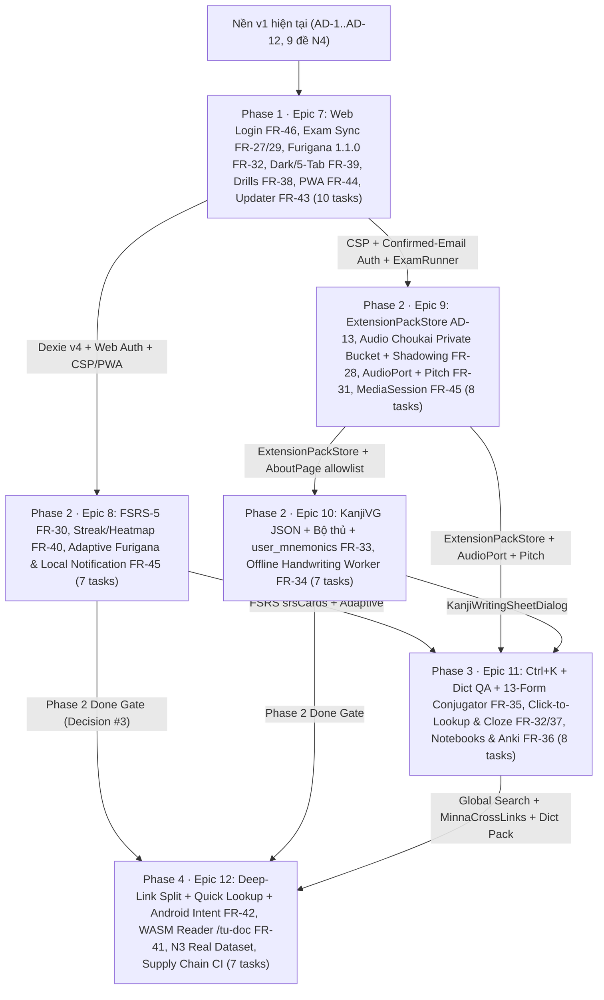

# Lộ trình Code, Bảo mật & QA v2 (Master Coordinator Index: Epic 7–12) Implementation Plan

> **For agentic workers:** REQUIRED SUB-SKILL: Use superpowers:subagent-driven-development (recommended) or superpowers:executing-plans along with `superpowers:verification-before-completion`, `open-code-review-delegate`, and `differential-review` to execute and verify each Epic in dependency order. Steps use checkbox (`- [ ]`) syntax for tracking.

**Goal:** Điều phối toàn bộ kế hoạch triển khai v2 (`FR-27..FR-46`, `AD-13..AD-19`) gồm 47 task triển khai trên 6 Epic (`Epic 7–12`), 22 kiểm soát bảo mật (`SEC-E7..E12`) và tháp kiểm thử 8 tầng (`SEC-T01..T12`) trên Web (PWA), Desktop Windows, Android và iOS.

**Architecture:** Khóa thứ tự thực thi bắt buộc từ nền Web Auth + Exam Sync + PWA + Updater (**Epic 7**) → tách song song hai nhánh độc lập là Động cơ FSRS + Streak/Adaptive/Nhắc học (**Epic 8**) và Hạ tầng Gói Mở rộng + Audio Choukai Bucket Riêng tư + MediaSession (**Epic 9**) → tiếp nối bằng KanjiVG + Viết tay Offline (**Epic 10**) → hợp nhất vào Từ điển + Sổ tay + Sentence Mining Cloze (**Epic 11**) → kết thúc ở Trình đọc WASM + Tiện ích Tauri 2 OS + Nhập N3 thật với **0% AI** (**Epic 12**).

**Tech Stack:** React 19, TypeScript 7, TanStack Router 1.131, TanStack Query 5, Dexie 4.4.7 (`luyen-jlpt` v4), Tailwind CSS 3.4 + shadcn/ui, Vite 8.3.4 + `vite-plugin-pwa`, Supabase Postgres 17 + Private Storage + Deno Edge Functions + pgTAP, Tauri 2.12.7 (`tauri-plugin-updater`, `tauri-plugin-http`, `tauri-plugin-fs`, `tauri-plugin-notification`, `tauri-plugin-global-shortcut`, `tauri-plugin-process`, `tauri-plugin-deep-link`), FFmpeg Opus, Lindera/IPADIC-UniDic WASM (BSD-3), Vitest 5.1.1, Playwright 1.65.1, `tauri-driver` 2.1.0, Android API 34 Emulator, Maestro 2.12.1.

**Spec & Companion Documents (9 tệp `2026-11-27-*.md`):**
1. `docs/initiative-jlpt-da-nen-tang/mazii-benchmark-va-ke-hoach-phat-trien.md` (Spec gốc BMAD v2 + 10 quyết định đã chốt)
2. `docs/superpowers/plans/2026-11-27-bao-mat-web-va-app-v2.md` (Kiểm toán bảo mật: `TM-01..TM-14`, `H1..H6`, `SEC-E7..E12`, `SEC-T01..T12`)
3. `docs/superpowers/plans/2026-11-27-epic-7-auth-web-luyen-de-pwa.md` (Phase 1, 10 tasks)
4. `docs/superpowers/plans/2026-11-27-epic-8-fsrs-adaptive-va-nhac-hoc.md` (Phase 2, 7 tasks)
5. `docs/superpowers/plans/2026-11-27-epic-9-audio-choukai-va-medianen.md` (Phase 2, 8 tasks)
6. `docs/superpowers/plans/2026-11-27-epic-10-kanjivg-va-viet-tay-offline.md` (Phase 2, 7 tasks)
7. `docs/superpowers/plans/2026-11-27-epic-11-tu-dien-so-tay-sentence-mining.md` (Phase 3, 8 tasks)
8. `docs/superpowers/plans/2026-11-27-epic-12-native-tauri-va-mo-rong-n3.md` (Phase 4, 7 tasks)
9. `docs/superpowers/plans/2026-11-27-ke-hoach-qa-tester-v2.md` (QA & Tester Playbook: Tháp 8 tầng, Ma trận `FR-27..FR-46`, Release Gate Phase 1–4)

## Global Constraints

- **Khóa 0% AI & 0 Ad-Tech (`AD-18`):** Không gọi LLM/AI API, không tracker/quảng cáo bên thứ ba (`0` request mạng ngoài khi học ngoại tuyến); không đưa ứng dụng lên Google Play/App Store trong v2 (ưu tiên Web PWA + GitHub Releases In-App Updater + Obtainium 0₫).
- **Bảo toàn nền v1 (`AGENTS.md`):** Giữ nguyên toàn bộ 18 route tiếng Việt cũ (chỉ bổ sung route mới `/so-tay`, `/tu-doc`, `/tra-nhanh`); `/ngu-phap/$patternId` không gắn quiz; `/tien-do` giữ `"Bạn chưa có tiến độ nào ở cấp độ này"` khi chưa có tiến độ (không `0%`, không heatmap trống); gói N4 `1.1.0` bảo toàn nguyên vẹn `1.182` từ vựng, `118` kanji, `388` từ ghép (`403` dòng nguồn), `148` mẫu ngữ pháp, `27/22/17/12/8` bảng phụ.
- **Ngân sách & Hạ tầng (`AD-13..AD-19`):** APK Android release **≤ 30 MB**; 3D chunk **≤ 3 MB** nén và **≥ 50 fps**; tra từ cục bộ **< 50 ms** trên `30.000` mục; phát audio cục bộ **< 150 ms**; nút **≥ 44×44px** ở `360px`; mọi chữ Nhật gắn `lang="ja"`; `ExtensionPackStore` không phụ thuộc `Cache Storage` trên Tauri.
- **Thứ tự N3 (`Quyết định #3`):** Chỉ kích hoạt nhập dữ liệu N3 thật (`Epic 12 Task 6`) sau khi **Phase 2 (`Epic 8, 9, 10`)** hoàn tất và vượt cổng kiểm tra trên N4.
- **Bản quyền dữ liệu mở:** `KANJIDIC2` (`CC BY-SA 4.0`), `KanjiVG` (`CC BY-SA 3.0`, gói JSON tách rời khỏi mã `AGPL-3.0-only`), `JMdict/EDICT` & `Kanjium` (`CC BY-SA 4.0`), `IPADIC/UniDic` (**BSD-3**). Ghi nguồn đầy đủ ở `/gioi-thieu` và `NOTICE*`.
- **Luật thép kiểm chứng:** Mỗi Epic và mỗi Phase kết thúc bằng `verification-before-completion`, `open-code-review-delegate` và `differential-review`.

## Review Focus

1. **Tránh va chạm timestamp migration Supabase giữa Epic 10 và Epic 11:** Epic 10 Task 3 dùng `20261127000400_user_mnemonics.sql`, nên Epic 11 Task 6 chốt dùng **`20261127000500_notebooks_and_items.sql`** (đã đồng bộ sang `000500` và khóa ở Bảng 3 bên dưới).
2. **Nhất quán schema Dexie `luyen-jlpt` v4 khi Epic 7 khai báo trước các store dùng ở Epic 8–11:** `db.version(4).stores(...)` ở Epic 7 Task 3 phải dùng đúng khóa chính cuối cùng của từng Epic sở hữu (`extensionPacks: "[packId+entryKey], packId, entryKey"` của Epic 9 và `userMnemonics: "[owner+level+kanjiId], owner, [owner+level]"` của Epic 10) để không phải nâng lên `db.version(5)` giữa chừng.
3. **Nút chặn `FR-46` Web Login trước khi mở Sync & Private Audio:** Không chạy kiểm thử đa thiết bị thật của `exam_attempts`, `srs_*`, hay `sign-audio-pack` trên môi trường production khi chưa xác nhận 6 giả thuyết `H1..H6` và triển khai xong `Epic 7 Task 1`.
4. **Rủi ro PWA Service Worker giữ kẹt code auth hoặc cache Signed URL:** `tests/web/pwa-offline.spec.ts` (`serviceWorkers: "allow"`) phải chạy trong CI cùng bộ test chuẩn (`serviceWorkers: "block"`) để bảo đảm `NetworkOnly` cho `*.supabase.co/*` không bao giờ bị hồi quy.
5. **Chạm nhầm tệp `desktop/src-tauri/` và `mobile/src-tauri/` khi chạy song song Epic 8 & Epic 9:** Vì Epic 8 (Task 7: `tauri-plugin-notification`) và Epic 9 (Task 2/5/7: `tauri-plugin-fs`, CSP `media-src`, `opener`) đều sửa `Cargo.toml`, `tauri.conf.json`, `capabilities/default.json` và `AboutPage.tsx`, cần hợp nhất tuần tự hoặc giao worktree riêng (`workspace: "share"`).

---

## 1. Thứ tự Thực thi & Đồ thị Phụ thuộc Chéo Epic (`Epic 7 → Epic 12`)



### Quy tắc Chạy Song song vs Tuần tự
- **Phase 1 (Epic 7, bắt buộc đi đầu):** Task 1 (`FR-46` Web Auth + `_headers` + CORS) là P0 Blocker mở đường deploy Web; Task 2–3 (`exam_attempts` + Dexie v4) mở khóa mô hình đồng bộ chung. Trong Epic 7, Task 6–8 (Furigana `1.1.0`, tìm kiếm/mini-drill, Dark mode + 5 tab) có thể chia song song sau khi chốt Task 3 `db.ts`.
- **Phase 2 (Epic 8 & Epic 9 song song → Epic 10 nối tiếp Epic 9):**
  - Epic 8 (`core/srs/`, `srs_cards`/`srs_reviews`, `activity.ts`) và Epic 9 (`core/extensions/`, `audio-packs`, `AudioPort`) chạy **song song được**, nhưng tách worktree/serialize lúc chạm chung `frontend/src/adapters/local-store/db.ts`, `desktop/src-tauri/`, `mobile/src-tauri/`, `frontend/src/pages/AccountPage.tsx`.
  - Epic 10 bắt đầu Task 1 (`svgSanitizer.ts` + `kanjivg-pack.ts`) song song ngay, và ghép vào `ExtensionPackStore` ở Task 2 ngay sau khi Epic 9 Task 2 hoàn tất.
- **Phase 3 (Epic 11):** Task 1 (`normalize.ts` + `conjugate.ts`) chạy độc lập được từ sớm; Task 2–8 dùng `ExtensionPackStore` (Epic 9), `srsCards` (Epic 8) và `KanjiWritingSheetDialog` (Epic 10).
- **Phase 4 (Epic 12):** Task 1–5 (`deepLinkDispatcher`, WASM Worker `/tu-doc`, Desktop `Ctrl+Shift+J`, Android Intent) nối sau Epic 11; **Task 6 (Nhập dataset N3 thật) bị khóa cho đến khi Phase 2 Gate (`Epic 8, 9, 10`) xanh 100%**.

---

## 2. Bảng Tổng hợp Theo Epic: Số Task, Kiểm soát Bảo mật & Cổng QA/E2E

| Epic | Phase | Plan File | Số Task | FR / AD chính | Kiểm soát Bảo mật (`SEC-*`) | Cổng Kiểm thử Bắt buộc (`SEC-T*` & E2E) |
| :--- | :--- | :--- | :---: | :--- | :--- | :--- |
| **Epic 7** | Phase 1 | `2026-11-27-epic-7-auth-web-luyen-de-pwa.md` | **10** | `FR-46`, `FR-27`, `FR-29`, `FR-32`, `FR-38`, `FR-39`, `FR-43`, `FR-44`, `AD-14`, `AD-19` | `SEC-E7-01..06` | `validate-web-env.test.ts`, `exam_attempts.test.sql` (`SEC-T05`), `functions.test.ts` (`SEC-T01`), `exams/progress.test.ts` (`SEC-T04`), `androidUpdate.test.ts` & `android-release.test.mjs` (`SEC-T08`), `tests/web/{auth-web-login,exam-practice,furigana-and-keigo,study-upgrades,theme-and-mobile-nav,pwa-offline}.spec.ts` (`SEC-T02..03`), `tests/desktop/{ci-smoke.ps1,updater-smoke.mjs}`, `tests/mobile/android-ci-smoke.sh` (APK `<= 30 MB`) |
| **Epic 8** | Phase 2 | `2026-11-27-epic-8-fsrs-adaptive-va-nhac-hoc.md` | **7** | `FR-30`, `FR-40`, `FR-45` (Adaptive + Notification), `AD-14`, `AD-19` | `SEC-E8-01..03` | `core/srs/*.test.ts`, `srs.test.sql` (`SEC-T07`), `local-store/srs.test.ts` (`SEC-T04`), `core/progress/activity.test.ts`, `core/exam/adaptiveRuby.test.ts`, `localNotifications.test.ts`, `tests/web/{fsrs-review,progress-streak-heatmap,adaptive-furigana}.spec.ts` (giữ empty-state `/tien-do`) |
| **Epic 9** | Phase 2 | `2026-11-27-epic-9-audio-choukai-va-medianen.md` | **8** | `AD-13`, `AD-15`, `FR-28`, `FR-31`, `FR-45` (`MediaSession`) | `SEC-E9-01..03` | `core/extensions/validate.test.ts`, `extensionTransport/dexieExtensionStore.test.ts`, `audio_packs.test.sql` & `functions.test.ts` (`SEC-T06`), `build-audio-packs/build-pitch-pack/tauri-csp-contract.test.ts` (`SEC-T09`), `webAudioAdapter/mediaSessionBridge.test.ts`, `ChoukaiPlayer.test.tsx`, `ExtensionPackManagerCard.test.tsx`, `tests/web/audio-choukai.spec.ts` (`< 150 ms`) |
| **Epic 10** | Phase 2 | `2026-11-27-epic-10-kanjivg-va-viet-tay-offline.md` | **7** | `FR-33`, `FR-34`, `AD-16` | `SEC-E10-01..03` | `svgSanitizer.test.ts` & `kanjivg-pack.test.ts` & `KanjiStrokePlayer.test.tsx` (`SEC-T10`), `user_mnemonics.test.sql` & `mnemonics.test.ts` (`SEC-T04`, `SEC-T07`), `strokeMatcher.test.ts` & `strokeMatcherClient.test.ts`, `GenkoyoshiCanvas.test.tsx`, `writingSheet.test.ts`, `tests/web/kanji-kanjivg.spec.ts` |
| **Epic 11** | Phase 3 | `2026-11-27-epic-11-tu-dien-so-tay-sentence-mining.md` | **8** | `FR-35`, `FR-36`, `FR-37`, `FR-32`, `FR-34` (PDF Sổ tay), `AD-13`, `AD-14` | `SEC-E11-01..03` | `normalize/conjugate.test.ts`, `dictionary/{validate,search}.test.ts` (`< 50 ms` / `30.000` mục), `dict-pack.test.ts` (QA ngữ nghĩa), `knowledgeGraph.test.ts`, `cloze/extract.test.ts`, `WordLookupHost.test.tsx`, `notebooks.test.sql` & `notebooks.test.ts` (`SEC-T04`, `SEC-T07`), `ankiCodec.test.ts` (`SEC-T11`), `NotebooksPage.test.tsx`, `tests/web/dictionary-notebooks.spec.ts` |
| **Epic 12** | Phase 4 | `2026-11-27-epic-12-native-tauri-va-mo-rong-n3.md` | **7** | `FR-41`, `FR-42`, `AD-16`, `AD-17`, `AD-18`, N3 thật | `SEC-E12-01..04` | `deepLinkDispatcher.test.ts` & `clipboardGuard.test.ts` (`SEC-T12`), `tokenizer-pack.test.ts` (BSD-3), `tokenizerClient.test.ts`, `localReader.test.ts`, `LocalReaderPage.test.tsx`, `verify-n3.test.ts`, `tests/desktop/capability-contract.test.mjs` (`SEC-T09`), `tests/mobile/android-intent-bridge.test.mjs` (`SEC-T12`), `tests/web/local-reader-n3.spec.ts` (`0% AI`), `tests/desktop/quick-lookup-smoke.mjs`, `pnpm audit` & `cargo audit` |
| **Tổng v2** | **4 Phases** | **6 Epic Plans + 2 Security/QA Plans** | **47** | `FR-27..FR-46`, `AD-13..AD-19` | **22 kiểm soát** | **Tháp 8 tầng + `SEC-T01..SEC-T12` + `open-code-review-delegate` + `differential-review`** |

---

## 3. Chuẩn hóa Hợp đồng Chéo Epic (Canonical Cross-Epic Interfaces)

**Interfaces:**
- **Consumes:** Toàn bộ kiến trúc `AD-1..AD-19`, đặc tả bảng ở `Epic 7–11` và yêu cầu khóa `SEC-*` từ `2026-11-27-bao-mat-web-va-app-v2.md`.
- **Produces:** Bộ định nghĩa chuẩn duy nhất mà mọi worker implement `Epic 7–12` phải tuân theo để tránh va chạm migration hoặc lệch chỉ mục Dexie v4:

1. **Thứ tự Migration Supabase Postgres (cấm trùng timestamp 14 chữ số):**
   - `backend/supabase/migrations/20261127000100_exam_attempts_sync.sql` *(Epic 7)*
   - `backend/supabase/migrations/20261127000200_srs_fsrs.sql` *(Epic 8)*
   - `backend/supabase/migrations/20261127000300_audio_packs_bucket.sql` *(Epic 9)*
   - `backend/supabase/migrations/20261127000400_user_mnemonics.sql` *(Epic 10)*
   - **`backend/supabase/migrations/20261127000500_notebooks_and_items.sql`** *(Epic 11: đổi từ `000400` sang `000500` để không đụng `user_mnemonics` của Epic 10)*

2. **Schema Hợp nhất Dexie `luyen-jlpt` v4 (`frontend/src/adapters/local-store/db.ts`):**
   Khi Epic 7 Task 3 nâng `db.version(4).stores(...)`, dùng đúng định nghĩa khóa chuẩn của từng Epic sở hữu dưới đây:
   - `packs: "[level+version]"` *(giữ v1)*
   - `settings: "key"` *(giữ v1)*
   - `progress: "[owner+level+kind+id], [owner+level], [owner+kind+id], owner"` *(giữ v2)*
   - `progressOutbox: "opId, owner"` *(giữ v2)*
   - `progressCursors: "[owner+kind]"` *(giữ v2)*
   - `examPacks: "[level+id]"` *(giữ v3)*
   - `examAttempts: "id, owner, [owner+level], [owner+level+examId], [owner+level+examId+status], completedAt"` *(Epic 7)*
   - `activeExamDrafts: "[owner+level+examId], owner"` *(Epic 7)*
   - `srsCards: "[owner+level+cardType+itemId], [owner+level+dueAt], [owner+level], owner"` *(Epic 8)*
   - `srsReviews: "id, [owner+level+reviewedAt], [owner+level+cardType+itemId], owner"` *(Epic 8)*
   - `extensionPacks: "[packId+entryKey], packId, entryKey"` *(Epic 9: dùng `[packId+entryKey]`, không dùng `id, [kind+level]`)*
   - `userMnemonics: "[owner+level+kanjiId], owner, [owner+level]"` *(Epic 10: có `level` khớp PK Supabase `user_id,level,kanji_id`)*
   - `notebooks: "id, owner, [owner+updatedAt]"` *(Epic 11)*
   - `notebookItems: "id, owner, [owner+notebookId], [owner+notebookId+itemType], [owner+itemType]"` *(Epic 11)*

3. **Danh mục `PROGRESS_KINDS` (`frontend/src/core/progress/index.ts`):**
   - v1 giữ nguyên: `"card_status"`, `"grammar_learned"`, `"kanji_quiz_attempts"`, `"reading_attempts"`
   - v2 mở rộng theo thứ tự Epic: `"exam_attempts"` (Epic 7) → `"srs_cards"`, `"srs_reviews"` (Epic 8) → `"user_mnemonics"` (Epic 10) → `"notebooks"`, `"notebook_items"` (Epic 11). Mọi bảng mới có `owner` đều phải nằm trong transaction `progressStore.purgeOwner(owner)` (`SEC-T04`).

4. **Tuyến đường Tiếng Việt Bổ sung (bên cạnh 18 route v1 bất biến):**
   - `/so-tay` (`NotebooksPage.tsx`, Epic 11)
   - `/tu-doc` (`LocalReaderPage.tsx`, Epic 12)
   - `/tra-nhanh` (`QuickLookupPage.tsx`, Epic 12: cửa sổ Desktop `quick-lookup` & target cho `luyenjlpt://lookup?q=...`)

5. **Hợp đồng `supabase-sync`, `core/progress` & Trigger Lock Chéo Epic:**
   - `notebooks` và `notebook_items` (Epic 11) không có cột `level` trên Postgres; phải khai báo `hasLevel: false` (nhánh `ProgressRow` tùy chọn `level`), `onConflict: "id"`, `ignoreDuplicates: false`, định tuyến `progressStore` về `db.notebooks` và `db.notebookItems` theo chỉ mục chuẩn `id, owner, [owner+notebookId], [owner+notebookId+itemType], [owner+itemType]`.
   - `supabase-sync/index.ts` dùng `cursorIdColumn` riêng theo từng bảng khi `pull()` vì nhiều bảng v2 không có cột `id`: `"item_id"` cho `srs_cards` (Epic 8), `"kanji_id"` cho `user_mnemonics` (Epic 10), `"id"` cho `exam_attempts`, `srs_reviews`, `notebooks`, `notebook_items`; đồng thời đặt `ignoreDuplicates: false` cho các bảng trạng thái (`srs_cards`, `user_mnemonics`, `notebooks`, `notebook_items`).
   - Gắn trigger `jlpt_private.lock_progress_writer()` lên `exam_attempts`, `srs_cards`, `srs_reviews` (và các bảng đồng bộ v2 mới); mọi lệnh kiểm thử Postgres dùng `supabase test db --workdir backend`.

6. **Thành phần UI, Preference & Security Headers Dùng chung:**
   - Chỉ giữ một component duy nhất tại `frontend/src/components/audio/PitchBadge.tsx` (Epic 9 sở hữu, Epic 11 tái sử dụng; không tạo `components/dictionary/PitchBadge.tsx`).
   - `InteractiveJaText` trên `ReadingDetailPage` và `GrammarDetailPage` (Epic 11) phải bảo toàn `useFuriganaPreference` (`passage.textRuby` / `example.reading` từ Epic 7) và `useMasteredKanji` (`furiganaMode` / `mastered` từ Epic 8).
   - `frontend/public/_headers` khóa `Permissions-Policy: microphone=()` tại Epic 7 Task 1 và cập nhật sang `Permissions-Policy: microphone=(self)` tại Epic 9 Task 6 để bật `MediaRecorder` cục bộ trong RAM cho `Thu giọng so sánh`; nếu Lindera-WASM cần `'wasm-unsafe-eval'`, phải kiểm chứng đồng bộ cả `_headers` và `tauri.conf.json`.

7. **Hợp đồng Native Capabilities, Script Env & Tương thích ngược:**
   - Mọi `<ExternalLink>` mới trong `AboutPage.tsx` (Kanjium/KanjiVG `CC BY-SA 3.0` ở Epic 9–10, EDRDG/JMdict ở Epic 11) phải đồng bộ danh sách `opener:allow-open-url` trong `desktop/src-tauri/capabilities/default.json`, `mobile/src-tauri/capabilities/default.json` và kiểm chứng `assert.deepEqual` tại `tests/mobile/android-release.test.mjs` (riêng BSD-3 IPADIC/UniDic ở Epic 12 trích dẫn văn bản thuần trong `AboutPage.tsx` và `NOTICE`, không mở URL ngoài).
   - `mobile/src-tauri/capabilities/android-update.json` gỡ `opener:allow-open-url` và `release-assets.githubusercontent.com` khi Kotlin/Rust tự tải APK qua `tauri-plugin-http`; `createMetadata(config, apkInfo?)` phải giữ tương thích ngược khi gọi 1 tham số (`mobile/scripts/validate-scaffold.mjs`, `tests/mobile/android-release.test.mjs`).
   - `infra/scripts/src/validate-native-env.mjs` bọc phần chạy CLI bằng `isMain` (`pathToFileURL`), còn `validateTauriCspConfig` đặt tại `infra/scripts/src/tauri-csp-contract.ts` (tránh cần `"allowJs": true` trong `infra/scripts/tsconfig.json`).
   - `QuickLookupPage` (Epic 12) chỉ đọc `dict-javi-core` qua `createDexieExtensionStore()` (không dùng `tauri-plugin-fs`) và bọc `try/catch` xử lý `NotAllowedError` cho `navigator.clipboard.readText()`; `patch-android-intents.mjs` phải giữ nguyên `usesCleartextTraffic="false"`, `networkSecurityConfig` và `FileProvider` (`exported="false"`) từ Epic 7.

8. **Cập nhật Regression Tests Cho Luồng FSRS (Epic 8):**
   - Khi thay `vocabulary.mark_known_button` bằng 4 nút FSRS, Epic 8 phải cập nhật đồng bộ `tests/web/routes.spec.ts`, `tests/web/guest-progress.spec.ts`, `tests/web/accounts.local.spec.ts` và `tests/desktop/smoke.mjs` theo luồng lật thẻ rồi bấm `vocabulary.fsrs.rate_3` (`"Tốt"`), giữ nguyên `[data-ocid="flashcard.status_badge"]` `"Đã thuộc"`.

---

## 4. Phân tầng Model Thực thi `/swarm` Đề xuất (Model Tiering)

Khi chạy `/swarm` thực thi `Epic 7–12`, phân bổ model theo rủi ro kỹ thuật để tối ưu độ chính xác lẫn tốc độ:

| Nhóm công việc | Model đề xuất | Lý do kỹ thuật & Phạm vi áp dụng |
| :--- | :--- | :--- |
| **Core, Security, DB Migrations, Tauri Native & Reviews** | **`Gemini 4 Neon High`** | Xử lý các nhánh rủi ro cao (`TM-01..TM-14`): chẩn đoán/vá `FR-46` Web Auth & CORS/Edge Functions, migration Supabase + RLS/trigger/pgTAP (`exam_attempts`, `srs_*`, `audio-packs`, `user_mnemonics`, `notebooks`), thuật toán thuần `FSRS-5`, `conjugateJapanese`, `strokeMatcher`, `svgSanitizer`, `ankiCodec`, mã Rust/Kotlin Tauri 2 (`android_updater.rs`, `ProcessTextBridgeActivity.kt`, capability isolation, CSP), và chạy `differential-review` / `open-code-review-delegate`. |
| **UI Pages, Components, Content Prep & Test Authoring** | **`Gemini 4 Hydrogen XHigh`** | Xây dựng component React + Tailwind/shadcn (`JlptScoreBreakdown`, `MiniDrillPanel`, `FsrsRatingBar`, `StudyHeatmap`, `ChoukaiPlayer`, `KanjiStrokePlayer`, `GenkoyoshiCanvas`, `GlobalSearchDialog`, `WordLookupHost`, `NotebooksPage`, `LocalReaderPage`), biên tập/kiểm duyệt dữ liệu Furigana `1.1.0` & từ điển, viết/mở rộng bộ test Vitest và Playwright E2E theo đúng `Interfaces` đã chốt. |

---

## 5. Cổng Hoàn thành Toàn bộ Sáng kiến v2 (`Verification-Before-Completion`)

Trước khi báo cáo hoàn tất toàn bộ v2 (hoặc chốt từng Phase 1–4), Coordinator và QA Lead bắt buộc thực thi đủ chuỗi kiểm chứng dưới đây trên checkout sạch và lưu bằng chứng thực tế (`exit 0`, số lượng pass/fail, không bỏ qua):

- [ ] **Bước 1: Toàn vẹn Gói Nội dung & Kiểu tĩnh:**
  ```bash
  pnpm packs:build && pnpm packs:verify
  EXPERIMENTAL_LEVELS=1 pnpm packs:build && EXPERIMENTAL_LEVELS=1 pnpm packs:verify
  pnpm typecheck && pnpm check
  ```
- [ ] **Bước 2: Unit, Adapter & Contract Tests (Tầng 1):**
  ```bash
  pnpm test
  pnpm --filter @luyen/mobile-shell test
  pnpm --filter @luyen/mobile-shell validate
  node --test tests/desktop/capability-contract.test.mjs tests/mobile/android-intent-bridge.test.mjs
  ```
- [ ] **Bước 3: Database pgTAP & Edge Functions Deno (Tầng 2 & `SEC-T01, T05, T06, T07`):**
  ```bash
  pnpm dlx supabase@3.2.0 --workdir backend start
  pnpm dlx supabase@3.2.0 --workdir backend test db
  pnpm dlx deno@2.9.6 test --no-config --no-lock --node-modules-dir=none backend/supabase/tests/functions.test.ts
  ```
- [ ] **Bước 4: Build Web, Env Gate, Sync Integration & Full Web/PWA E2E (Tầng 3, 4 & `SEC-T02, T03`):**
  ```bash
  node infra/scripts/src/validate-web-env.mjs
  pnpm build
  pnpm e2e:web
  pnpm e2e:web tests/web/pwa-offline.spec.ts
  ```
  *(Và chạy đủ bộ 2-tài khoản `JLPT_LOCAL_AUTH=1 pnpm e2e:web accounts.local.spec.ts account-mail.local.spec.ts` như `.github/workflows/ci.yml#L45-L54`.)*
- [ ] **Bước 5: Native Desktop & Android Smoke + Ngân sách APK `<= 30 MB` (Tầng 5, 6, 8 & `SEC-T08, T09, T12`):**
  - Windows: `pwsh -File tests/desktop/ci-smoke.ps1`, `tests/desktop/updater-smoke.mjs`, `node tests/desktop/quick-lookup-smoke.mjs`.
  - Android: `bash tests/mobile/android-ci-smoke.sh`, `node mobile/scripts/android-release.mjs metadata <apk>`, kiểm dung lượng APK release `<= 31.457.280` bytes.
  - iOS (trên `macos-15`): `bash tests/mobile/ios/ci-smoke.sh`.
- [ ] **Bước 6: Supply Chain & Reviews (Tầng 7 + Cổng cuối):**
  ```bash
  pnpm audit --prod --audit-level=high
  cargo audit --file desktop/src-tauri/Cargo.lock
  cargo audit --file mobile/src-tauri/Cargo.lock
  ```
  Hoàn tất `open-code-review-delegate` (`coverage_rate === 100%`) + `differential-review` + `semgrep` với **0 Critical/High**; kiểm tra trực tiếp trên thiết bị thật (Windows `.exe`, Android `.apk`, iPhone Safari PWA) theo Mục 3.3 của `2026-11-27-ke-hoach-qa-tester-v2.md`.
